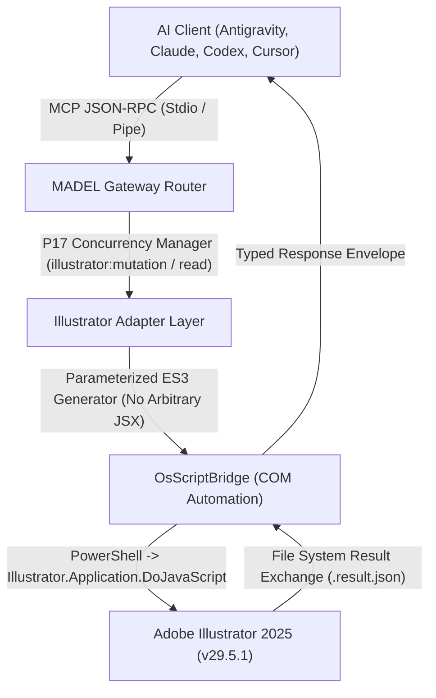

# MADEL Studio Bridge — Adobe Illustrator Adapter
**Application:** Adobe Illustrator 2025 (v29.5.1+)  
**Lead Architect & Owner:** Mahmoud Adel (`Mahmoudmarktingiq`)  
**Phase:** P21 — Vectors, Artboards & SVG Integration  
**Architecture Pattern:** Modular Extensible Application Adapter  

---

## 1. Architectural Role & Execution Flow

This adapter provides safe, typed, and isolated communication between MADEL Studio Bridge and Adobe Illustrator on Windows.

---

## 2. API Selection & Industry Roadmap Analysis

### Why ExtendScript via COM Automation?
- **Adobe Official Status (September 2026 Announcement):** Adobe announced that public UXP for Adobe Illustrator is targeted for **Spring 2027 (Beta)**. Adobe Illustrator 2025 (v29.5.1) currently lacks public UXP APIs for third-party developers.
- **ExtendScript / COM (`Illustrator.Application`):** The proven, battle-tested, fully documented official automation interface on Windows.
- **Zero Port Conflict:** Unlike Photoshop (which uses WebSocket on port 7897 for UXP), Illustrator is driven panel-less via COM without opening network sockets or competing for port 7897.
- **Future-Proof Modular Decoupling:** Tool handlers in `packages/server/src/tools/illustrator.ts` interface cleanly through the adapter. When Illustrator UXP is publicly released by Adobe in 2027, the backend transport can be swapped to a UXP panel without altering MCP tool names or schemas.

---

## 3. Security Principles

1. **No Arbitrary JSX Injection:** Clients cannot send arbitrary ExtendScript code strings over the wire. All actions use typed, validated schemas whose parameters are sanitized and interpolated into pre-compiled ES3 templates.
2. **File System Sandboxing:** Temporary bootstrap files are stored in `.brainferno-mcp-bridge/temp/` with UUID prefixes and automatically swept upon completion.
3. **Confirmed Destructive Actions:** Destructive operations like `ai_delete_object` strictly require `confirm: true`.
