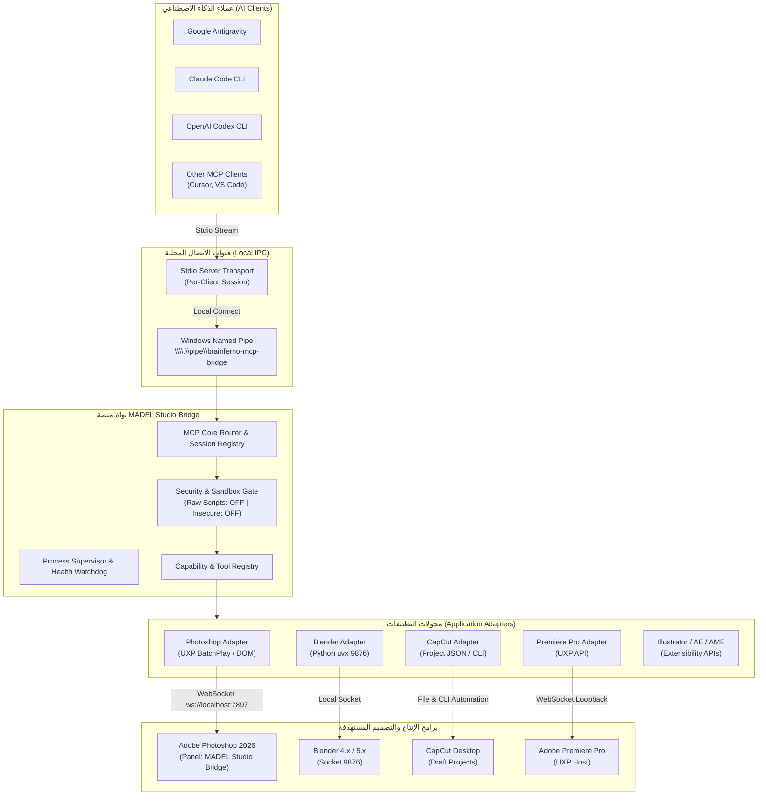

# MADEL Studio Bridge — Architecture & Technical Design
**المشروع:** MADEL Studio Bridge  
**المطور والمشرف:** Mahmoud Adel — محمود عادل  
**الإصدار:** 1.0.0-Architecture  
**تاريخ التوثيق:** 10 نوفمبر 2026

---

## 1. المخطط المعماري العام (High-Level Architecture)

---

## 2. الأنظمة الفرعية العشرة للمنصة (The 10 Core Subsystems)

### 1. النواة المركزية لـ MCP (MCP Core Engine):
- تستقبل تدفقات JSON-RPC القياسية عبر موصلات Stdio لكل عميل على حدة.
- تدير جلسات العملاء المتزامنة وتربط كل جلسة بنسخة معزولة من `McpServer` تتشارك نفس حالة التشغيل `Runtime`.

### 2. محولات التطبيقات المعيارية (Application Adapters):
- تطبق نمط التصميم **Adapter Pattern** بحيث يمتلك كل برنامج (Photoshop، Blender، CapCut) محولاً مستقلاً تماماً ومفصولاً عن الآخر.
- يوفر المحول دوال موحدة: `detect()`, `connect()`, `disconnect()`, `listCapabilities()`, `execute()`, `healthCheck()`.

### 3. موصلات العملاء (Client Connectors):
- وحدات تكوين سريعة لقراءة وكتابة إعدادات العملاء المدعومة:
  - Antigravity: `~/.gemini/config/mcp_config.json`
  - Claude Code: `~/.claude.json`
  - OpenAI Codex: `~/.codex/config.toml`

### 4. مدير المهارات (Skills Manager):
- يربط الأدوات البرمجية المعقدة بملفات تعليمات الوكلاء (Agent Skills) مثل مهارة `capcut-edit` ومهارات الرسم ثلاثي الأبعاد لـ Blender.

### 5. بوابة الأمان والصلاحيات (Security & Permissions Gate):
- تطبيق مبدأ **Least Privilege**:
  - `BRAINFERNO_MCP_ALLOW_RAW_SCRIPTS=0` (حظر السكربتات العشوائية افتراضياً).
  - `BRAINFERNO_MCP_BRIDGE_INSECURE=0` (فرض مصادقة التوكن).
  - حظر الاتصال عبر `0.0.0.0` وحصر الشبكة على Loopback `127.0.0.1` و `localhost`.

### 6. خدمة استكشاف البرامج (Application Discovery Service):
- فحص مسارات التثبيت في ويندوز وسجلات النظام (Registry / Program Files / AppData) لاكتشاف وجود التطبيقات وإصداراتها الدقيقة قبل محاولة ربطها.

### 7. مدير التشخيص والاتصال (Connection & Diagnostic Manager):
- التحقق اللحظي من حالة المقابس والمنافذ (`7897`, `9876`) وقراءة حالة الاتصال عبر أداة `cc_connected_apps` الموحدة.

### 8. مدير الحزم والمثبت الموحد (Installer & Package Manager):
- تجميع إضافات UXP في حزم CCX رسمية (`MADEL-Studio-Bridge-Photoshop.ccx`)، وتوليد ملفات التكوين التلقائية.

### 9. نظام السجلات والتدقيق (Logs & Audit System):
- توحيد سجلات الخوادم واللوحات في مجلد `D:\MCP\logs\` ومطابقة السجلات الميدانية للوحة Photoshop.

### 10. محرك التحديث والتراجع (Update & Rollback Engine):
- إدارة النسخ الاحتياطية واسترجاع الإعدادات بضغطة زر عند الرغبة في التراجع أو التحديث.

---

## 3. معمارية مضاعفة الاتصال المحلي (Named Pipe Multiplexer Architecture)

لحل مشكلة تنازع المنفذ 7897 بين عملاء الذكاء الاصطناعي:
1. **Primary Daemon:** العملية الأولى التي تبدأ تربط مقبس WebSocket على المنفذ `7897` لاستقبال لوحة Photoshop، وتفتح مستمع الأنبوب المسمى:
   `\\.\pipe\brainferno-mcp-bridge`
2. **Client Multiplexers:** أي عملية ثانية أو ثالثة (سواء استدعاها Claude Code أو Codex أو Antigravity) تفحص الأنبوب المسمى، وبمجرد اكتشافه تتصل به فوراً وتقوم بتمرير (pipe) تدفقات Stdio إلى الخادم الأساسي.
3. **النتيجة:** صفر تضارب في المنافذ، صفر كتابة مكررة لملف `bridge.json`، وجلسات متزامنة كاملة ومستقرة.

---

## 4. نظام سياق الطلب وإدارة التزامن في البوابة (Gateway Request Scoping & Concurrency — P17)

لإدارة الطلبات المتزامنة بأمان دون حدوث تضارب في محركات التطبيقات أحادية المسار (Single-Threaded Engines):

1. **سياق الطلب غير المتزامن (AsyncLocalStorage Request Context):**
   - توليد `requestId` و `correlationId` فريدين لكل طلب وتمريرهما تلقائياً عبر سلاسل الـ Promises.
   - ربط إشارة إلغاء `AbortSignal` بالطلب لإلغاء العمليات فور انقطاع العميل.
   - حجب وتطهير كامل لأي أسرار أو مفاتيح أو بيانات شخصية.

2. **منظم العمليات المقيد (Bounded FIFO WorkLimiter):**
   - طابور FIFO صارم يحدد الحد الأقصى للمهام النشطة والمهام المنتظرة.
   - تطبيق ضغط عكسي (Backpressure) فوري عند امتلاء الطابور برمز `QUEUE_OVERFLOW` (-32001).
   - مهلة مزدوجة: مهلة انتظار الطابور (`queueWaitTimeoutMs`) ومهلة التنفيذ القصوى (`executionTimeoutMs`).

3. **الطوابير المعزولة حسب نطاق المورد (Resource-Scoped Concurrency Manager):**
   - عزل طوابير التطبيقات المستقلة؛ عمليات Photoshop لا تحظر عمليات Blender أو معالجات FFmpeg الصوتية.
   - تسلسل إجباري للعمليات المعدلة للمستندات والمشاهد (`photoshop:mutation`, `blender:mutation`).
   - إخلاء فوري للمهام المعلقة لعميل معين عند انقطاع اتصاله (`cancelTasksForClient`).

4. **مقاييس الرصد والمراقبة اللحظية (Observability & Metrics):**
   - قياس وتتبع لحظي لعدد الطلبات النشطة، والمنتظرة، والمكتملة، والملغاة، ومتوسط زمن الانتظار والتنفيذ.
   - توفير لقطات إحصائية (Snapshots) جاهزة للربط مع لوحة التحكم المستقبلية (P19 Dashboard).

---

## 5. المدير الموحد لعملاء الذكاء الاصطناعي ونظام التكوين الذري (Unified AI Client Manager & Atomic Config Subsystem — P18)

لإدارة اكتشاف وتكوين عملاء الذكاء الاصطناعي بأعلى معايير الأمان الموثوقة:

1. **السجل التعريفي الشامل (Declarative Client Registry):**
   - تعريف تصريحي متكامل لـ 17+ عميل ذكاء اصطناعي (Claude Code, Claude Desktop, OpenAI Codex, Google Antigravity, Gemini CLI, Cursor, VS Code, VS Code Insiders, Windsurf, Cline, Roo Code, Continue, OpenCode, JetBrains, GitHub Copilot, Goose, Generic MCP).
   - اعتماد مسارات ديناميكية خالية تماماً من المسارات الصلبة (Zero Hardcoded Paths) بالاعتماد على متغيرات بيئة النظام (`%USERPROFILE%`, `%APPDATA%`, `%LOCALAPPDATA%`, `$HOME`).
   - دعم التوسع الديناميكي عبر واجهة تسجيل برمجية (`register(client)`).

2. **محرك الاكتشاف غير التدخلي (Non-Invasive Discovery Engine):**
   - فحص آمن ومقروء فقط (Read-Only) لمسارات التثبيت، والملفات التنفيذية، والعمليات النشطة، وملفات الإعدادات.
   - تحديد دقيق لحالة العميل عبر 7 حالات محددة: `not_installed`, `installed`, `detected`, `configured`, `connected`, `unsupported`, `not_verified`.

3. **المحللات المعيارية متعددة الصيغ (Multi-Format Parsers):**
   - معالجة سلسة لأربع صيغ تكوين شائعة:
     - **JSON:** التكوين القياسي لمعظم العملاء.
     - **JSONC:** تجريد آمن للتعليقات أحادية ومتعددة الأسطر مع حماية علامات التنصيص والروابط.
     - **TOML:** محلل مستقل ونظيف تماماً (Clean-Room) لهيكل تكوين OpenAI Codex (`[mcp_servers]`).
     - **YAML:** محلل هرمي متدرج لقوائم وإعدادات عملاء مثل Goose.

4. **محرك الكتابة الذرية ذو الخطوات التسع (9-Step High-Assurance Atomic Writer):**
   - **الخطوة 1:** حساب بصمة SHA-256 للملف الحالي قبل أي تعديل.
   - **الخطوة 2:** إنشاء نسخة احتياطية مختومة بالوقت (`.bak.<timestamp>`) تلقائياً.
   - **الخطوة 3:** فحص تصادم التعديلات الخارجية (Anti-Race Condition check).
   - **الخطوة 4:** كتابة البيانات الجديدة إلى ملف مؤقت عشوائي في نفس المجلد الأصلي لضمان تجنب عبر حدود وسائط التخزين (Cross-Device Move).
   - **الخطوة 5:** فحص ومطابقة محتوى وبصمة الملف المؤقت قبل النقل.
   - **الخطوة 6:** استبدال الملف الأصلي ذرياً عبر `fs.rename` مع حلقة إعادة محاولة ذكية (Retry Loop with Jitter) لتجاوز أقفال ملفات ويندوز المؤقتة (`EBUSY` / `EPERM`).
   - **الخطوة 7:** التأكد النهائي من وجود وبصمة الملف المستبدل.
   - **الخطوة 8:** تنظيف أي ملفات مؤقتة متبقية.
   - **الخطوة 9:** الاسترجاع التلقائي (Automatic Rollback) للنسخة الاحتياطية الأصلية في حال حدوث أي خطأ طارئ.

5. **سياسة الحفاظ التام على الإعدادات المسبقة (Preservation Policy):**
   - الحفاظ الإلزامي بنسبة 100% على خوادم MCP التابعة لأطراف أخرى والموجودة مسبقاً في ملفات تكوين العميل.
   - الحفاظ على الحقول الإضافية وإعدادات واجهات المستخدم دون حذف أو تشويه.

6. **واجهة سطر الأوامر (CLI) والواجهة البرمجية (API):**
   - توفير أدوات سطر أوامر متكاملة: `madel clients [list|detect|inspect|plan|connect|disconnect|backup|restore|verify]`.
   - توفير واجهة برمجية TypeScript جاهزة للربط المباشر مع واجهة التحكم المستقبلية (P19 Desktop Dashboard).

---

## 6. تطبيق سطح المكتب الأصلي وشريط المهام لويندوز (Native Desktop Dashboard & System Tray — P19)

بناء تطبيق مكتبي أصلي متكامل يجمع بين السرعة الفائقة والأمان الهندسي لمراقبة وإدارة المنصة:

1. **حزمة التقنيات المعتمدة (Technology Stack):**
   - **Tauri v2:** إطار عمل مكتبي خفيف وسريع يعتمد لغة Rust لتقليل استهلاك الذاكرة (RAM < 45 MB).
   - **Vue 3 + Pinia + TypeScript:** إدارة حالة استجابية حديثة ومكونات واجهة نموذجية.
   - **Microsoft Edge WebView2:** محرك عرض صفحات نظام ويندوز الافتراضي دون تضمين متصفحات ثقيلة كـ Chromium.
   - **Vite 6:** بيئة بناء فائقة السرعة بزمن توليد حزم 722 مللي ثانية.

2. **قناة الاتصال الآمنة (Secure IPC Bridge):**
   - استدعاء عمليات محددة فقط عبر وسيط `bridge-rpc.js` بالاعتماد على `std::process::Command::new("node")` دون وسيط شل ودون إمكانية حقن الأوامر.
   - حظر كامل لاستدعاء أي أوامر نظام أو Shell من الواجهة الرسومية.
   - حظر فتح أي منافذ شبكية جديدة أو تشغيل ديمون مكرر (No Secondary Daemon).

3. **سلوك شريط المهام ودورة حياة النافذة (System Tray & Lifecycle):**
   - دمج أيقونة مخصصة في منطقة الإشعارات (Tray Icon) مع قائمة سريعة للتحكم.
   - تطبيق قاعدة **`Close Window != Stop All MCP Servers`**؛ إغلاق النافذة يخفيها فقط ويحافظ على استمرار خوادم MCP في العمل لخدمة نماذج الذكاء الاصطناعي دون انقطاع.

4. **نظام التصميم المستقل (Visual Design System):**
   - واجهة مستوحاة من Microsoft Fluent و Apple HIG.
   - وضع ليلي أساسي (Fluent Obsidian) ووضع نهاري اختياري (Fluent Clean).
   - دعم التدويل واللغة العربية (i18n & RTL Ready).

---

## 7. محرك أدوات Photoshop الإبداعية المتقدمة (Advanced Photoshop Creative Engine — P20)

لتوسيع قدرات منصة MADEL Studio Bridge بأدوات إبداعية احترافية غير مدمرة:

1. **إدارة الكائنات الذكية (Smart Objects Subsystem):**
   - تحويل الطبقات إلى كائنات ذكية مدمجة (`newPlacedLayer`).
   - استعلام الخصائص الوصفية بدقة عبر خاصية `smartObjectMore` و `smartObject`.
   - التمييز الإبداعي الحاسم بين النسخ المرتبط (الافتراضي) والنسخ المستقل المقطوع الصلة عبر `placedLayerMakeCopy`.
   - استبدال المحتويات ديناميكياً (`placedLayerReplaceContents`) عبر رموز وصول جلسات UXP (`createSessionToken`).
   - مزامنة وتحديث الكائنات المرتبطة خارجياً (`placedLayerUpdateModified`).

2. **محرك أنماط الطبقات المعالج برمجياً (Layer Styles & Effects Engine):**
   - إدارة مباشرة لهيكل `layerEffects` على كرت الشاشة (GPU Procedural Styles).
   - الدمج التراكمي للأنماط وتجنب تضارب التكرار (`Multi` arrays).
   - دعم كامل للظل، التوهج، الشطف، التجسيم، الحشوات المتدرجة والمتصلة، والحدود.

3. **التحديدات الهندسية وأقنعة الطبقات (Selections & Raster Layer Masks):**
   - تحديدات هندسية مستطيلة ودائرية مع دعم أنماط الدمج الأربعة: `replace`, `add`, `subtract`, `intersect`.
   - تنعيم الحواف (Feather) والعكس (Invert) والاستعلام عن حدود التحديد ومساحته.
   - إنشاء أقنعة الطبقات (`revealSelection`, `hideSelection`, `revealAll`, `hideAll`).
   - تبديل تفعيل القناع برمجياً (`userMaskEnabled`).
   - سياسة أمان صارمة لحذف الأقنعة تفرض تمرير `confirm: true` لحماية البيانات من الضياع العرضي.

4. **محرك الطباعة الاحترافية والتصدير (Print Prepress Engine & Production Export):**
   - دعم مباشر لمساحة ألوان الطباعة التجارية `CMYKColorMode` ودقة 300 DPI.
   - استخراج القياسات الفيزيائية بالمليمتر والبوصة إلى جانب البيكسلات.
   - تعديل دقة الطباعة الفيزيائية دون إعادة أخذ العينات من البيكسلات (`resample: false`).
   - تصدير TIFF عالي الجودة مع دعم ضغط LZW وحفظ ملفات تعريف الألوان ICC.

---

## 8. محرك أتمتة الفيكتور ومساحات العمل لبرنامج Adobe Illustrator (Illustrator Vector Engine — P21)

تم بناء محرك فيكتور متكامل لبرنامج Adobe Illustrator 2025 مع عزل تشغيلي ثنائي المسار (Dual-Lane Isolation):

1. **المسار التشغيلي والأتمتة الهجينة (COM ExtendScript & UXP 2027 Path):**
   - اعتماد الأتمتة الموثوقة عبر Windows COM (`Illustrator.Application.DoJavaScript`) المتوافقة 100% مع بيئة ويندوز دون الحاجة إلى تشغيل لوحات واجهة مستخدم تفاعلية يدوية.
   - فصل كامل عن سيرفر الفوتوشوب UXP (المنفذ 7897 / PID 15940) لضمان عدم حدوث تضارب في المنافذ أو تعليق العمليات.
   - هندسة نمطية مجردة في `adapters/illustrator-adapter/` تتيح التبديل السلس إلى واجهات UXP المستقبلية المخططة من أدوبي في ربيع 2027 دون كسر التوافقية لأدوات الذكاء الاصطناعي.

2. **محرك المسارات الفيكتورية ومنحنيات بيزييه (Vector Geometry & Bézier Curves):**
   - تحويل رياضي دقيق بين نظام إحداثيات Canvas/ويب المعياري (الذي ينطلق من الزاوية العلوية اليسرى ويزداد محور Y إلى الأسفل) ونظام PostScript الأصلي لبرنامج الإليستريتور (الذي ينطلق من الأسفل ويزداد محور Y إلى الأعلى).
   - توليد منحنيات بيزييه ثلاثية الأبعاد الحرة (`ai_create_path`) مع تحكم دقيق بمقابض المماس (`inHandle` / `outHandle`) ونقاط الارتكاز الملساء والحادة (`PointType.SMOOTH` و `PointType.CORNER`).
   - دعم المسارات المركبة (`ai_create_compound_path`) للأشكال المعقدة والتفريغ والقص.

3. **إدارة مساحات العمل والـ Artboards:**
   - إنشاء ديناميكي لعدة Artboards بأبعاد فيزيائية محددة بالنقاط والمليمتر والبوصة.
   - تغيير الأحجام وإعادة التسمية والتبديل التلقائي لمساحة العمل النشطة.

4. **الطباعة والتصدير والإنتاج المعياري:**
   - دعم كامل للنصوص النقطية والنصوص الحرة المحتواة داخل أشكال هندسية (`areaText`).
   - تصدير SVG قياسي مشفر بـ UTF-8 مع تحديد موقع أنماط CSS (`style_elements` أو `presentation_attributes`).
   - تصدير PDF فيكتوري عالي الجودة مع الحفاظ على القابلية للتعديل، وتصدير PNG حتى 300 PPI.
   - سياسة أمان تفرض تأكيد الحذف الصريح `confirm: true` لمنع حذف العناصر بالخطأ.

---

## 9. محرك مونتاج الفيديو وأتمتة التايم لاين لبرنامج Adobe Premiere Pro (Premiere Video & Timeline Engine — P22)

تم بناء وتكامل محرك مونتاج الفيديو لبرنامج Adobe Premiere Pro 2026 عبر واجهات UXP الرسمية:

1. **نموذج المعاملات الذري والقفل المحمي (Transactional UXP Action Model):**
   - تنفيذ كافة عمليات التعديل والقص والإدراج داخل كتل `project.lockedAccess` ومعاملات `project.executeTransaction`.
   - ضمان أن كل أداة MCP تمثل خطوة تراجع واحدة واضحة وقابلة للإلغاء في تاريخ المشروع (Clean Undo Stack).

2. **محرك التوقيت والتكات الصحيحة فائق الدقة (Integer Tick Precision Engine):**
   - اعتماد قاعدة التوقيت المعيارية لبريمير برو ($254,016,000,000\text{ Ticks/Sec}$).
   - القضاء التام على أخطاء التقريب العشري والأطر الناقصة أو الزائدة (Off-by-One Frame Errors).
   - التوافق التام مع 8 معدلات إطارات قياسية (23.976، 24، 25، 29.97، 30، 50، 59.94، 60 FPS) وتوليد كود التوقيت SMPTE بنمطي Drop Frame و Non-Drop Frame.

3. **هيكلية المسارات المتعددة وإدارة الأصول (Multi-Track & Asset Management):**
   - أدوات متخصصة لفحص مسارات الفيديو والصوت وقفلها وكتمها.
   - إدارة متكاملة للمشروع: إنشاء المشروعات وحفظها، استيراد الوسائط، إنشاء الـ Bins، وإعادة تنظيم العناصر.

4. **تأمين العمليات التدميرية والتصدير:**
   - فرض تأكيد صريح `confirm: true` لحذف المقاطع من التايم لاين.
   - اكتشاف قوالب التصدير وتصدير إطارات المعاينة وسلاسل الفيديو عبر بريمير أو Adobe Media Encoder.

---

## 10. بوابة أتمتة المتصفحات والمراجع البصرية لمتصفحات كروميوم (Browser MCP Gateway — P23)

تم بناء وتكامل بوابة تحكم وأتمتة لمتصفحات كروميوم (Google Chrome و Microsoft Edge على ويندوز):

1. **التحكم المباشر عبر بروتوكول DevTools (CDP Native Automation):**
   - اتصال فائق السرعة عبر WebSocket محلي على منافذ ديناميكية (127.0.0.1:EPHEMERAL).
   - استخدام محرك كروميوم المثبت أصلياً على ويندوز دون الحاجة إلى تنزيل حزم أو ملفات متصفحات ضخمة.

2. **عزل الجلسات والأمان الصارم (Session Isolation & Security):**
   - إنشاء ملفات تعريف مؤقتة ومعزولة (`--user-data-dir`) لكل جلسة تُحذف تلقائياً عند الإغلاق.
   - استحالة الوصول أو تسريب الكوكيز أو كلمات المرور أو الحسابات الشخصية للمستخدم.
   - قائمة بيضاء صارمة لبروتوكولات الروابط (`http:`, `https:`, والملفات المحلية المصرح بها ضمن مساحات العمل).
   - حظر كامل للبروتوكولات الخطرة (`javascript:`, `data:`, `chrome:`, `edge:`).
   - حماية الملفات الحساسة وفرض موافقة صريحة (`approved: true`) لرفع الملفات.
   - حصر إنهاء العمليات على الـ PIDs التي أنشأتها MADEL فقط؛ عدم إغلاق متصفح المستخدم الشخصي نهائياً.

3. **حزمة الأدوات المتكاملة (27 أداة MCP):**
   - **إدارة المتصفح:** اكتشاف المتصفحات، إنشاء الجلسات، حصر الجلسات، وإغلاقها بأمان.
   - **الملاحة والتاريخ:** فتح الروابط، الانتقال، إعادة التحميل، والتنقل في السجل.
   - **فحص المحتوى:** قراءة النصوص، فحص عناصر DOM، البحث عن العناصر، استخراج الميتاداتا، وحصر الروابط.
   - **التفاعل المتقدم:** النقر، الكتابة، اختيار القوائم، التمرير، انتظار العناصر، ورفع الملفات بأمان.
   - **التشخيص الهندسي:** مراقبة أخطاء الكونسول، رصد أخطاء الشبكة، قياس الأداء، والتقاط شجرة الوصول (AX Tree).
   - **التقاط لقطات الشاشة:** لقطات كاملة عالية الدقة وحفظها مباشرة في مساحات العمل الإبداعية.

## 11. محرك الموشن جرافيكس والتصيير لتطبيق Adobe After Effects (After Effects Motion & Render Engine — P24)

تم بناء وتكامل محرك متكامل ومستقل للتحكم في برنامج Adobe After Effects وإدارة مشاريع الموشن جرافيكس:

1. **نموذج ExtendScript ES3 والمعاملات الذرية (Atomic Undo Encapsulation):**
   - توليد سكربتات مضمنة متوافقة كلياً مع محرك ExtendScript (ES3) الخالي من شفرات ES6+ غير المدعومة بالهوست.
   - تغليف كل أداة تعديل داخل معاملة ذرية `app.beginUndoGroup(...) / app.endUndoGroup()` لضمان خطوة تراجع Undo واحدة نظيفة لكل أداة (`Ctrl+Z`).
   - حقن تمهيدي خفيف الوزن (`__comp`, `__layer`, `__undo`, `__layerInfo`) للوصول المحدد بالرقم التعريفي أو الاسم الحرفي مع كشف التكرار.

2. **محرك التصيير الخلفي aerender.exe المستقل (Non-Blocking Headless Render):**
   - تنفيذ خلفي آمن عبر استدعاء `aerender.exe` بمصفوفة وسائط صارمة خالية من الحقن (`child_process.spawn`).
   - حظر تجميد واجهة المستخدم أثناء التصيير وإتاحة متابعة العمل التشاركي بين الإنسان والذكاء الاصطناعي.
   - فرض موافقة صريحة (`approved: true`) كحارس أمان إلزامي قبل تشغيل أي عملية تصيير أو حفظ للمشروع.

3. **الدقة الرياضية الزمنية والمكانية (Timing Math & Spatial Geometry):**
   - محرك حسابات دقيق يغطي 8 معدلات إطارات قياسية (23.976 إلى 60 FPS) دون انحرافات حسابية.
   - دعم كامل لأكواد الوقت SMPTE بنوعيها Drop-Frame (`;`) و Non-Drop-Frame (`:`).
   - تحويل الإحداثيات الطبيعية المقيسة إلى بكسلات ثنائية وثلاثية الأبعاد 2D/3D مع ضبط نقاط الارتكاز Anchor Points.
   - تحكم ديناميكي في منحنيات الحركة وتنعيم المفاتيح عبر `KeyframeEase` وأنماط الاستيفاء (Linear, Bezier, Hold).

4. **حزمة الأدوات الموسعة (57 أداة MCP — 231 أداة إجمالية في المنصة):**
   - **المشاريع (6 أدوات):** استعلام المشاريع، إنشاء مشروع جديد، فتح وحفظ المشاريع، وحصر واستيراد الميديا.
   - **الكومبوزشن (5 أدوات):** حصر الكومبوزشن، إنشاء كومبوزشن، فحص الخصائص، تعديل الأبعاد، وتفعيل المشهد في نافذة العرض.
   - **الطبقات (10 أدوات):** حصر الطبقات، إنشاء نصوص، إنشاء مصمتات، إنشاء أشكال، إعادة التسمية، حذف الطبقات (بحارس `confirm: true`)، التحكم بالرؤية، وتعديل التوقيت.
   - **التحريك والتحويلات (9 أدوات):** فحص التحويلات، تعيين الموضع، التكبير، الدوران، الشفافية، تعيين وحذف المفاتيح، واستيفاء المنحنيات.
   - **الموشن جرافيكس وMOGRT (6 أدوات):** تحريك الأشكال التلقائي، قوالب حركات النصوص، إضافة التأثيرات، وتصدير قوالب الموشن جرافيكس.
   - **التصيير والتشخيص (6 أدوات):** فحص طابور التصيير، إضافة عناصر للطابور، تصدير إطار مفرد، التصيير الخلفي عبر aerender، وفحص ملفات النتائج على القرص.
   - **الدفعة والمرافق والتراجع (15 أداة):** البحث عن الطبقات، استيراد ككومبوزشن، الأقنعة، الأنماط، العلامات، التراجع/الإعادة، وتنفيذ السكربتات الموثوقة.

5. **إدارة التزامن وحصص الموارد (Concurrency Scoping):**
   - توجيه عمليات التعديل لنطاق `after_effects:mutation` (تزامن 1، مهلة طابور 30 ثانية، مهلة تنفيذ 60 ثانية).
   - توجيه عمليات التصيير لنطاق `after_effects:render` (تزامن 1، مهلة طابور 120 ثانية، مهلة تنفيذ 600 ثانية).

