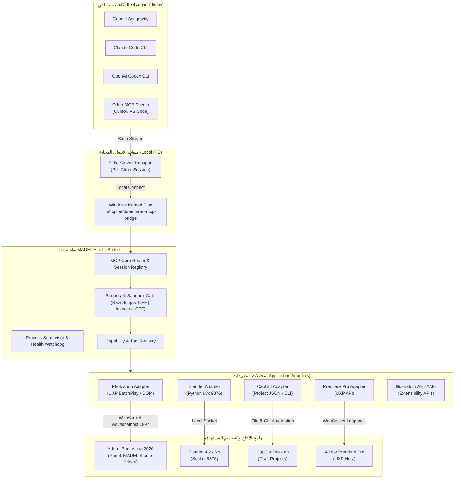

# MADEL Studio Bridge — Architecture & Technical Design
**المشروع:** MADEL Studio Bridge  
**المطور والمشرف:** Mahmoud Adel — محمود عادل  
**الإصدار:** 1.0.0-Architecture  
**تاريخ التوثيق:** 10 نوفمبر 2026

---

## 1. المخطط المعماري العام (High-Level Architecture)

---

## 2. الأنظمة الفرعية العشرة للمنصة (The 10 Core Subsystems)

### 1. النواة المركزية لـ MCP (MCP Core Engine):
- تستقبل تدفقات JSON-RPC القياسية عبر موصلات Stdio لكل عميل على حدة.
- تدير جلسات العملاء المتزامنة وتربط كل جلسة بنسخة معزولة من `McpServer` تتشارك نفس حالة التشغيل `Runtime`.

### 2. محولات التطبيقات المعيارية (Application Adapters):
- تطبق نمط التصميم **Adapter Pattern** بحيث يمتلك كل برنامج (Photoshop، Blender، CapCut) محولاً مستقلاً تماماً ومفصولاً عن الآخر.
- يوفر المحول دوال موحدة: `detect()`, `connect()`, `disconnect()`, `listCapabilities()`, `execute()`, `healthCheck()`.

### 3. موصلات العملاء (Client Connectors):
- وحدات تكوين سريعة لقراءة وكتابة إعدادات العملاء المدعومة:
  - Antigravity: `~/.gemini/config/mcp_config.json`
  - Claude Code: `~/.claude.json`
  - OpenAI Codex: `~/.codex/config.toml`

### 4. مدير المهارات (Skills Manager):
- يربط الأدوات البرمجية المعقدة بملفات تعليمات الوكلاء (Agent Skills) مثل مهارة `capcut-edit` ومهارات الرسم ثلاثي الأبعاد لـ Blender.

### 5. بوابة الأمان والصلاحيات (Security & Permissions Gate):
- تطبيق مبدأ **Least Privilege**:
  - `BRAINFERNO_MCP_ALLOW_RAW_SCRIPTS=0` (حظر السكربتات العشوائية افتراضياً).
  - `BRAINFERNO_MCP_BRIDGE_INSECURE=0` (فرض مصادقة التوكن).
  - حظر الاتصال عبر `0.0.0.0` وحصر الشبكة على Loopback `127.0.0.1` و `localhost`.

### 6. خدمة استكشاف البرامج (Application Discovery Service):
- فحص مسارات التثبيت في ويندوز وسجلات النظام (Registry / Program Files / AppData) لاكتشاف وجود التطبيقات وإصداراتها الدقيقة قبل محاولة ربطها.

### 7. مدير التشخيص والاتصال (Connection & Diagnostic Manager):
- التحقق اللحظي من حالة المقابس والمنافذ (`7897`, `9876`) وقراءة حالة الاتصال عبر أداة `cc_connected_apps` الموحدة.

### 8. مدير الحزم والمثبت الموحد (Installer & Package Manager):
- تجميع إضافات UXP في حزم CCX رسمية (`MADEL-Studio-Bridge-Photoshop.ccx`)، وتوليد ملفات التكوين التلقائية.

### 9. نظام السجلات والتدقيق (Logs & Audit System):
- توحيد سجلات الخوادم واللوحات في مجلد `D:\MCP\logs\` ومطابقة السجلات الميدانية للوحة Photoshop.

### 10. محرك التحديث والتراجع (Update & Rollback Engine):
- إدارة النسخ الاحتياطية واسترجاع الإعدادات بضغطة زر عند الرغبة في التراجع أو التحديث.

---

## 3. معمارية مضاعفة الاتصال المحلي (Named Pipe Multiplexer Architecture)

لحل مشكلة تنازع المنفذ 7897 بين عملاء الذكاء الاصطناعي:
1. **Primary Daemon:** العملية الأولى التي تبدأ تربط مقبس WebSocket على المنفذ `7897` لاستقبال لوحة Photoshop، وتفتح مستمع الأنبوب المسمى:
   `\\.\pipe\brainferno-mcp-bridge`
2. **Client Multiplexers:** أي عملية ثانية أو ثالثة (سواء استدعاها Claude Code أو Codex أو Antigravity) تفحص الأنبوب المسمى، وبمجرد اكتشافه تتصل به فوراً وتقوم بتمرير (pipe) تدفقات Stdio إلى الخادم الأساسي.
3. **النتيجة:** صفر تضارب في المنافذ، صفر كتابة مكررة لملف `bridge.json`، وجلسات متزامنة كاملة ومستقرة.
