# MADEL Studio Bridge — Unified Installer Design Specification
**اسم المثبت:** MADEL Studio Bridge Setup  
**المطور والمشرف:** Mahmoud Adel — محمود عادل  
**الإصدار:** 1.0.0-Setup  
**تاريخ التوثيق:** 10 نوفمبر 2026

---

## 1. فلسفة ورؤية التثبيت الموحد (Unified Installer Philosophy)

يهدف **MADEL Studio Bridge Setup** إلى تقديم تجربة تثبيت احترافية وسلسة بنقرة واحدة، تغني المستخدم عن التعامل اليدوي مع موجهات الأوامر أو تعديل ملفات JSON وTOML الحساسة. يقوم المثبت تلقائياً باكتشاف البرامج المثبتة على حاسبة المستخدم، وعرض خيارات التثبيت الانتقائي، والامتثال التام للسياسات الأمنية لنظام التشغيل ومنصات Adobe.

---

## 2. المراحل التسع لمعالج التثبيت (The 9-Step Wizard Flow)

```mermaid
flowchart LR
    S1["1. Welcome"] --> S2["2. License & Attribution"]
    S2 --> S3["3. Detect Installed Apps"]
    S3 --> S4["4. Choose Applications"]
    S4 --> S5["5. Choose AI Clients"]
    S5 --> S6["6. Review Permissions"]
    S6 --> S7["7. Safe Installation"]
    S7 --> S8["8. Live Diagnostics"]
    S8 --> S9["9. Completion"]
```

### تفاصيل المراحل:
1. **Welcome (الترحيب):** تقديم هوية MADEL Studio Bridge وشعارها، مع تعريف المطور Mahmoud Adel.
2. **License & Attribution (التراخيص والاشتقاق):** عرض رخصة Apache-2.0 والإشعار الصريح باشتقاق كود الربط من Brainferno MCP Bridge مع حفظ كافة الحقوق.
3. **Detect Installed Applications (الكشف التلقائي عن التطبيقات):**
   - فحص وجود Adobe Photoshop (تم اكتشاف: v27.8.0).
   - فحص وجود Blender (تم اكتشاف: Blender 4.x/5.x).
   - فحص وجود CapCut Desktop.
   - فحص وجود Premiere Pro وAfter Effects وIllustrator.
4. **Choose Applications (اختيار التطبيقات):**
   - قائمة اختيار تتيح للمستخدم تحديد البرامج التي يرغب في تفعيل التحكم بها.
   - البرامج غير المثبتة تظهر بوضوح كـ `Not Installed` مع تعطيل خيارها افتراضياً دون إجبار.
5. **Choose AI Clients (اختيار عملاء الذكاء الاصطناعي):**
   - كشف عملاء MCP المثبتين تلقائياً: Google Antigravity، Claude Code، OpenAI Codex، Cursor، VS Code.
   - اختيار البيئات المطلوب تسجيل الخادم داخلها تلقائياً.
6. **Review Required Permissions (مراجعة الصلاحيات الأمنية):**
   - عرض صريح للصلاحيات المطلوبة: الاتصال المحلي حصراً عبر Loopback `127.0.0.1`، مع التأكيد على عدم طلب أي صلاحيات مسؤول (Administrator) وعدم تعديل جدار الحماية (Firewall) أو Defender.
7. **Safe Installation (التثبيت الآمن):**
   - إنشاء النسخ الاحتياطية لملفات الإعداد الحالية.
   - كتابة إعدادات Stdio الخاصة بـ MADEL Studio Bridge.
   - فتح حزمة CCX الرسمية للإضافة في Photoshop.
8. **Live Diagnostics (اختبار الاتصال الميداني):**
   - فحص عمل المقابس وقراءة استجابة `cc_connected_apps`.
9. **Completion (اكتمال التثبيت):**
   - عرض ملخص بحالة الربط، وفتح لوحة التحكم Dashboard.

---

## 3. التعامل مع إضافات Adobe والامتثال الرسمي (Adobe Policy Compliance)

- **حظر التثبيت الصامت غير المصرح:** لا يقوم المثبت بتجاوز نظام حماية ويندوز أو حقن ملفات UXP سراً دون علم المستخدم.
- **الاعتماد على CCX الرسمي:** يتم تجميع إضافات UXP في حزمة `MADEL-Studio-Bridge-Photoshop.ccx` وتشغيلها عبر تطبيق **Adobe Creative Cloud Desktop** الرسمي ليتولى فحص التوقيع وإعلام المستخدم بالموافقة.
- **الحفاظ على Developer Mode:** إرشاد المستخدم لتفعيل Developer Mode إذا رغب في تحميل الإضافة محلياً عبر UXP Developer Tool.

---

## 4. وظائف الصيانة والتراجع وإلغاء التثبيت (Maintenance & Rollback)

يوفر المثبت الموحد واجهات صيانة تشمل:
- **Repair Installation (إصلاح التثبيت):** إعادة توليد ملف الهاندشيك وإعادة تسجيل الخادم لدى عملاء MCP في حال فقدان الاتصال.
- **Update Installation (تحديث التثبيت):** تحديث حزم المحولات عند توفر إصدارات جديدة مع الحفاظ الكامل على إعدادات المستخدم.
- **Rollback (التراجع التلقائي):** استعادة ملفات النسخ الاحتياطية المؤرخة فوراً بضغطة زر واحدة.
- **Uninstall (إلغاء التثبيت النظيف):** إزالة خادم MADEL من ملفات إعدادات العملاء واسترجاع الوضع الأصلي النظيف.
