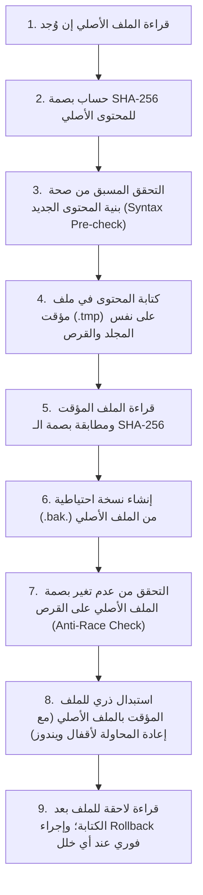

# MADEL Studio Bridge — خوارزمية الكتابة الذرية الآمنة (Atomic Configuration Writing)
**المشروع:** MADEL Studio Bridge — Phase P18  
**المالك والمهندس المشرف:** Mahmoud Adel — محمود عادل  
**المسار المصدري:** `packages/server/src/clients/atomic-writer.ts`  
**تاريخ التوثيق:** 10 نوفمبر 2026  
**الحالة:** **PRODUCTION READY & HARDENED**

---

## 1. التحدي الهندسي (The Technical Problem)

في أنظمة التشغيل (وبالأخص ويندوز)، تعديل ملفات إعدادات البرامج النشطة (مثل `Code`, `Cursor`, `Claude`) يواجه ثلاثة مخاطر جسيمة:
1. **تلف الملف أثناء انقطاع التيار أو الإغلاق المفاجئ (Partial Write Corruption):** إذا كتب الخادم نصف الملف ثم انقطع التيار، يتدمر ملف إعدادات العميل ويفقد المستخدم كل إعداداته.
2. **أقفال الملفات في ويندوز (Windows File Locks / `EPERM` / `EBUSY`):** عندما يكون محرر الأكواد فاتحاً للملف، قد يفشل التعديل العادي المباشر فوراً.
3. **التعديلات المتزامنة المتضاربة (Race Conditions):** إذا قام العميل نفسه أو المستخدم بتعديل الملف أثناء قيام خادم MADEL بقراءته وتعديله.

---

## 2. خوارزمية الخطوات التسع للكتابة الذرية (The 9-Step Atomic Writing Algorithm)

### تفاصيل الخطوات:
1. **قراءة الملف الأصلي:** فحص وجود الملف وجلب محتواه الحالي.
2. **حساب البصمة الرقمية:** توليد بصمة SHA-256 فريدة للمحتوى الأصلي. إذا كان المحتوى الجديد مطابقاً تماماً، تنتهي العملية فوراً بنجاح دون أي مساس بالقرص.
3. **التحقق البنائي المسبق:** التحقق من أن النص الجديد هو JSON أو TOML أو YAML سليم 100%؛ إذا كانت هناك شائبة بنائية، تُلغى العملية فوراً قبل فتح أي ملف كتابة.
4. **الملف المؤقت في نفس المجلد:** كتابة النص في ملف باسم `${filePath}.tmp.${randomHex}` في **نفس المجلد حصراً** لضمان أن عملية التبديل تتم على نفس القرص (Volume)، مما يتيح لنظام الملفات تنفيذ استبدال ذري عبر الـ Inode/MFT دون نسخ فيزيائي.
5. **التحقق من سلامة الملف المؤقت:** قراءة محتوى الملف المؤقت من القرص والتأكد التام من مطابقة بصمته للبيانات المعدة.
6. **النسخ الاحتياطي التلقائي الموثق:** نسخ الملف الأصلي إلى `${filePath}.bak.${timestamp}` لحفظ نسخة مرجعية يمكن للمستخدم استرجاعها في أي وقت.
7. **حماية التضارب (Anti-Race Condition):** قراءة الملف الأصلي مرة ثانية في أجزاء من الثانية ومقارنة بصمته؛ إذا تغير الملف بواسطة تطبيق آخر أثناء التجهيز، يُحذف الملف المؤقت وتُلغى العملية مع إشعار `Concurrent modification detected`.
8. **الاستبدال الذري وتجاوز أقفال ويندوز:** استبدال الملف المؤقت بالملف النهائي عبر `renameSync`. في حال اعتراض نظام ويندوز بخطأ `EPERM` أو `EBUSY` بسبب قفل محرر الأكواد، يقوم النظام بإعادة المحاولة حتى 3 مرات مع تأخير زمني أسي (Exponential Backoff).
9. **الفحص والتحقق بعد الكتابة (Post-Write Verification):** قراءة الملف النهائي بعد استقراره على القرص؛ إذا حدث أي عدم تطابق غير متوقع، يقوم النظام فوراً باسترجاع النسخة الاحتياطية (Rollback) وحذف الملف التالف.
