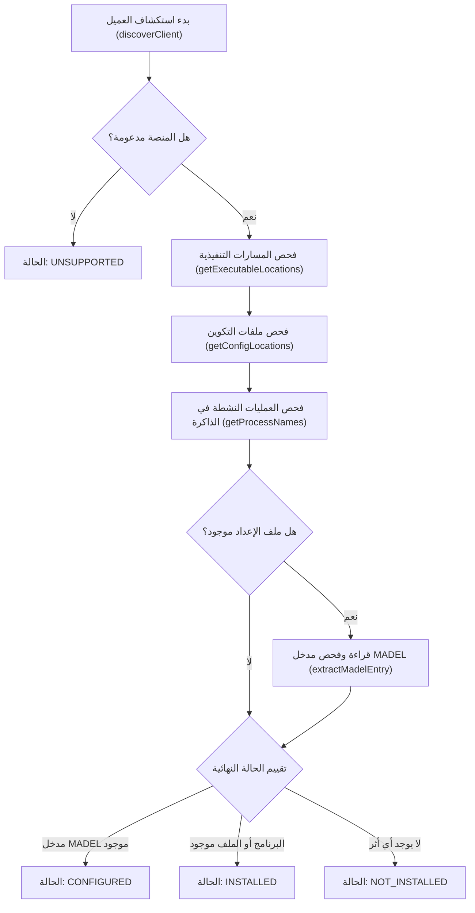

# MADEL Studio Bridge — محرك استكشاف عملاء الذكاء الاصطناعي (Client Discovery Engine)
**المشروع:** MADEL Studio Bridge — Phase P18  
**المالك والمهندس المشرف:** Mahmoud Adel — محمود عادل  
**المسار المصدري:** `packages/server/src/clients/discovery.ts`  
**تاريخ التوثيق:** 10 نوفمبر 2026  
**الحالة:** **PRODUCTION READY & NON-INVASIVE**

---

## 1. مبدأ الاستكشاف غير التدخلي (Non-Invasive Read-Only Principle)

محرك الاستكشاف في MADEL Studio Bridge مصمم ليعمل بأسلوب **القراءة البحتة (Read-Only Inspection)**:
- لا يقوم بإنشاء أي ملفات أو مجلدات أثناء الاستكشاف.
- لا يعدل أي إعدادات للمستخدم.
- لا يقوم بتشغيل أي برامج أو أوامر طرفية مشبوهة.
- لا يتطلب صلاحيات مدير النظام (Administrator Elevation).

---

## 2. الحالات السبع للعميل (The 7 Client Status Classifications)

للتمييز بين الوجود الفعلي والاتصال الحقيقي وتفادي الادعاءات الوهمية:

| الحالة (Status) | الرمز البرمجي | المعنى الهندسي الدقيق |
| :--- | :--- | :--- |
| **مثبت (Installed)** | `installed` | تم العثور على الملف التنفيذي للبرنامج أو مجلد التثبيت الرسمي على النظام. |
| **غير مثبت (Not Installed)** | `not_installed` | لم يتم العثور على أي ملف تنفيذي أو ملف إعدادات لهذا العميل على الجهاز. |
| **مكتشف (Detected)** | `detected` | تم رصد عملية قيد التشغيل في الذاكرة تخص هذا العميل. |
| **مُهيأ (Configured)** | `configured` | ملف تكوين العميل موجود على القرص ويحتوي بالفعل على مدخل MADEL Studio Bridge. |
| **متصل حياً (Connected)** | `connected` | العميل قام بمصافحة MCP نشطة حالياً عبر Stdio أو Named Pipe مع خادم MADEL. |
| **غير مدعوم (Unsupported)** | `unsupported` | العميل غير متوافق مع نظام التشغيل الحالي (مثلاً عميل يعمل على macOS فقط). |
| **غير موثق حياً (Not Verified)** | `not_verified` | العميل مُهيأ على القرص، ولكن لم يتم بعد التحقق من اتصاله الفعلي في جلسة عمل جارية. |

> [!IMPORTANT]
> **قاعدة الشفافية:**  
> وجود ملف التكوين أو إضافة مدخل MADEL لا يعني تلقائياً أن العميل متصل حالياً؛ لا يتم إعلان حالة `Connected` إلا عند حدوث مصافحة حقيقية للبروتوكول.  
> كما يؤكد النظام أن واجهة ChatGPT على الويب أو تطبيق سطح المكتب العام لا يدعمان نفس آلية الربط المحلي لخادم OpenAI Codex CLI.

---

## 3. خوارزمية الاستكشاف التدريجية (Discovery Pipeline)



---

## 4. النتائج الحقيقية الميدانية على الجهاز (Live Machine Discovery Results)

عند تشغيل أمر الاستكشاف الميداني `madel clients detect` على حاسبة المهندس محمود عادل، تم رصد النتائج التالية:

```text
Scanning system for installed and configured AI clients...
--------------------------------------------------------------------------------
* claude-code        : [INSTALLED]      | [NOT CONNECTED]    | C:\Users\asus\.claude.json
* claude-desktop     : [NOT INSTALLED]  | [NOT CONNECTED]    | C:\Users\asus\AppData\Roaming\Claude\claude_desktop_config.json
* openai-codex       : [INSTALLED]      | [NOT CONNECTED]    | C:\Users\asus\.codex\config.toml
* google-antigravity : [INSTALLED]      | [NOT CONNECTED]    | C:\Users\asus\.gemini\config\mcp_config.json
* gemini-cli         : [NOT INSTALLED]  | [NOT CONNECTED]    | C:\Users\asus\.gemini\settings.json
* cursor             : [NOT INSTALLED]  | [NOT CONNECTED]    | C:\Users\asus\.cursor\mcp.json
* vscode             : [NOT INSTALLED]  | [NOT CONNECTED]    | C:\Users\asus\AppData\Roaming\Code\User\settings.json
--------------------------------------------------------------------------------
```

تم اكتشاف العملاء الثلاثة المثبتين فعلياً على الجهاز (`Claude Code`, `OpenAI Codex`, `Google Antigravity`) بدقة متناهية ودون أي تداخل في المسارات.
