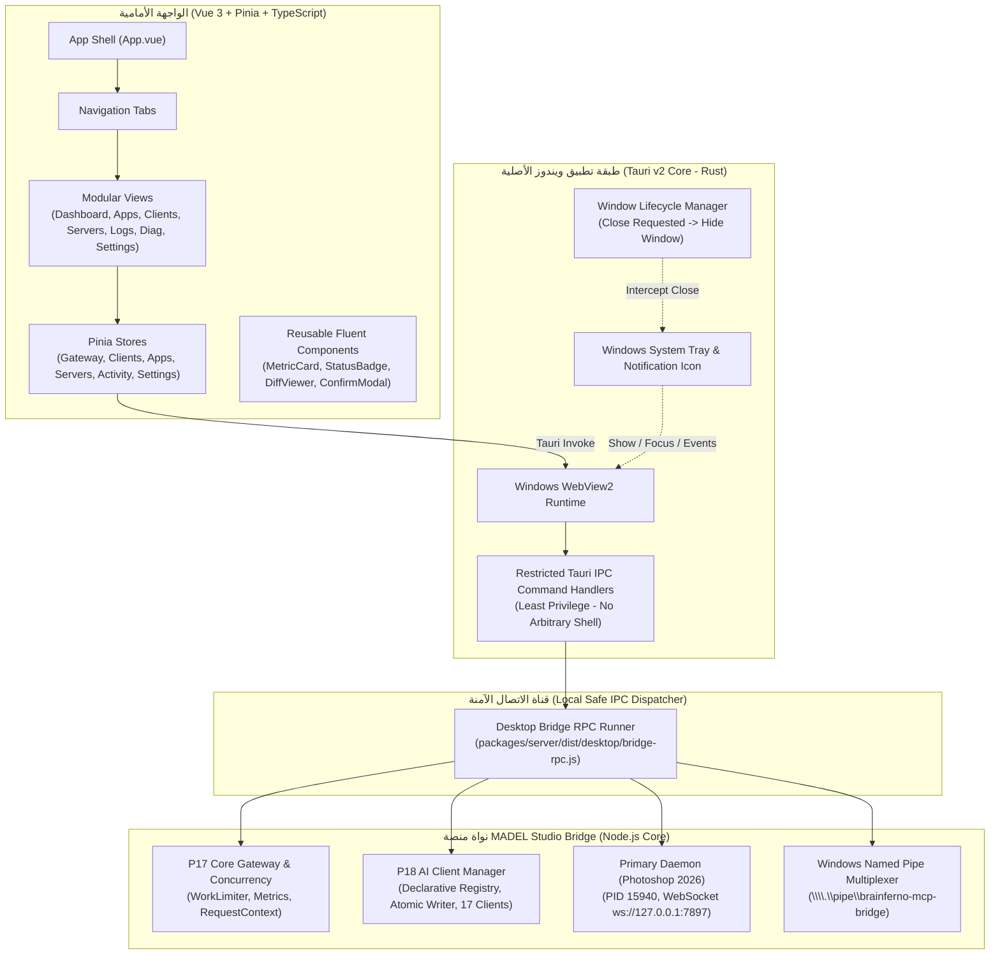

# MADEL Studio Bridge — معمارية تطبيق سطح المكتب (P19 Desktop Architecture)
**المشروع:** MADEL Studio Bridge — Phase P19  
**المالك والمهندس المشرف:** محمود عادل — Mahmoud Adel  
**المسار المصدري:** `apps/desktop/`  
**تاريخ التوثيق:** 10 نوفمبر 2026  
**الإصدار:** 0.5.0-Desktop

---

## 1. المخطط المعماري العام (System Architecture Overview)

---

## 2. الأنظمة الفرعية للواجهة وتطبيق سطح المكتب (Desktop Subsystems)

### 1. غلاف التطبيق وهيكل التصفح (App Shell & Navigation):
- تصميم سطح مكتب استجابي يعتمد إطار Microsoft Fluent و Apple HIG.
- شريط علوي (`AppHeader.vue`) يعرض حالة البوابة اللحظية، ومؤشرات الاتصال، وزر التحديث الفوري، ومبدل الوضع الليلي والنهاري، واختيار اللغة (EN / AR).
- قائمة جانبية عمودية ثابتة (`AppSidebar.vue`) للتنقل السريع بين الأقسام السبعة دون إعادة تحميل الصفحة.
- شريط سفلي (`AppFooter.vue`) يعرض رقم العملية الحالية، وحالة الأنبوب المسمى، ومعلومات حقوق التطوير ("Developed and maintained by Mahmoud Adel").

### 2. إدارة الحالة المركزية (Pinia Stores):
- **`useGatewayStore`**: مراقبة ومزامنة حالة خادم البوابة وإحصائيات التزامن الحقيقية من P17 كل 5 ثوانٍ.
- **`useClientsStore`**: إدارة استكشاف العملاء، وفحص التكوين، وتوليد الفوارق (Diff Preview)، وتطبيق التعديل الذري مع النسخ الاحتياطي التلقائي.
- **`useAppsStore`**: تصنيف البرامج حسب مستوى الجاهزية الفعلي وعزل البرامج قيد التخطيط.
- **`useServersStore`**: تدقيق خوادم وقنوات MCP وعدد الأدوات المتاحة.
- **`useActivityStore`**: تجميع وتصفية سجلات الأحداث وتطهير البيانات الحساسة ونسخ تقارير التشخيص.
- **`useSettingsStore`**: إدارة تفضيلات المظهر، وسلوك شريط المهام، وبدء التشغيل، واللغة.

### 3. معمارية التوصيل الآمن بين Rust ونواة MADEL (Safe IPC Bridge Architecture):
- **حظر تام للأوامر العشوائية:** لا يُسمح للواجهة الرسومية بتنفيذ أي أوامر Shell مباشرة.
- **المنفذ الحصري المعتمد:** تقوم دالة `invoke_bridge_op` في لغة Rust باستدعاء ملف `bridge-rpc.js` المبني والموثوق حصراً باستخدام `std::process::Command::new("node")` دون وسيط شل.
- **التحقق الصارم من العمليات:** تقبل النواة 12 عملية محددة فقط ضمن قائمة بيضاء (Whitelist). أي عملية غير مصرح بها تُرفض فوراً.
- **حماية العمليات قيد التشغيل:** لا يقوم التطبيق بإعادة تشغيل خادم Photoshop أو إيقافه أو إنشاء ديمون مكرر (No Secondary Daemon).

### 4. سلوك ودورة حياة شريط المهام (Windows System Tray Lifecycle):
- دمج أيقونة مخصصة في منطقة الإشعارات بجوار ساعة ويندوز عبر `TrayIconBuilder`.
- القائمة السريعة:
  1. **Open MADEL Studio Bridge:** إظهار النافذة والتركيز عليها.
  2. **Gateway Status: Active:** بيان حالة البوابة.
  3. **Open Diagnostics:** فتح شاشة الفحص والتشخيص مباشرة.
  4. **Settings:** فتح شاشة الإعدادات.
  5. **Quit MADEL Desktop:** إنهاء تطبيق الواجهة الرسومية فقط.
- **قاعدة فصل النافذة عن الخوادم (Close Window ≠ Stop MCP Servers):**  
  عند النقر على زر إغلاق النافذة `[X]`، يتم اعتراض الحدث عبر `WindowEvent::CloseRequested` وإخفاء النافذة في منطقة الإشعارات دون إيقاف خوادم MCP، لحماية جلسات Claude Code و OpenAI Codex و Google Antigravity النشطة.
