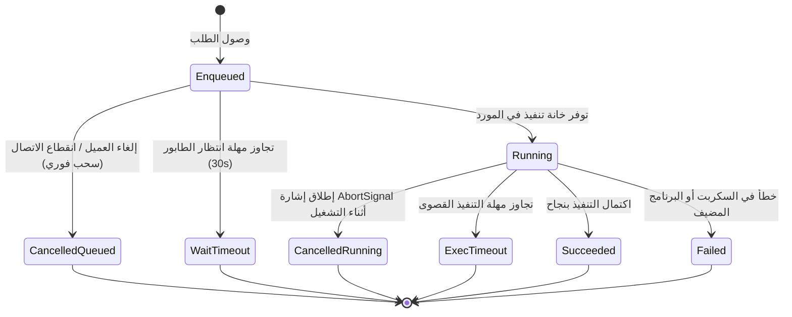

# MADEL Studio Bridge — دلالات وقواعد الإلغاء ومهل الانتظار (Cancellation Semantics & Timeouts)
**المشروع:** MADEL Studio Bridge — Phase P17  
**المالك والمهندس المشرف:** Mahmoud Adel — محمود عادل  
**المسار المصدري:** `packages/server/src/gateway/`  
**تاريخ التوثيق:** 10 نوفمبر 2026  
**الحالة:** **OFFICIAL SPECIFICATION & PROTOCOL RULES**

---

## 1. التمييز الدقيق بين حالات الإلغاء (Distinction of Cancellation States)

تحدد منصة MADEL Studio Bridge قواعد واضحة ودقيقة للتعامل مع الإلغاء والمهل الزمنية عبر أربع حالات منفصلة تماماً:

### الحالة الأولى: إلغاء الطلبات المنتظرة في الطابور (Queued Cancellation)
- **التعريف:** إلغاء يتم أثناء وجود الطلب في طابور الانتظار قبل دخوله مرحلة المعالجة في التطبيق المضيف.
- **الضمانات:**
  - ضمان أمان بنسبة 100%؛ الطلب لم يرسل مطلقاً إلى البرنامج المضيف.
  - لا تحدث أي تعديلات على المستندات أو المشاهد أو الملفات.
  - إخلاء فوري من الذاكرة وإلغاء المؤقتات وتحرير مكان في الطابور للطلبات التالية.
  - رمز الاستجابة: `REQUEST_CANCELLED` مع تفصيل `{ queued: true }`.

### الحالة الثانية: إلغاء الطلبات قيد التنفيذ (Running Cancellation)
- **التعريف:** إلغاء يتم بعد إرسال الطلب بالفعل عبر الـ WebSocket أو الأنبوب إلى لوحة Photoshop UXP أو محرك Blender.
- **الحقيقة الهندسية الحاكمة:**
  > [!IMPORTANT]
  > **إشارة `AbortSignal` البرمجية لا تضمن التراجع عن عملية بدأت بالفعل داخل المحرك المضيف (Host Engine).**  
  > إذا كان Photoshop قد بدأ تنفيذ `batchPlay` لقص صورة أو دمج طبقات، فإن إشارة الإلغاء في البوابة توقف انتظار استجابة النتيجة فقط لمنع تجميد عميل الذكاء الاصطناعي، لكنها لا تستطيع سحب الأوامر التي دخلت بالفعل في النواة التنفيذية لبرنامج Adobe.
- **الإجراء:** إعلان أن الإلغاء أوقف انتظار النتيجة (`Awaiting result aborted`)، وحجز خانة التزامن حتى ينتهي خيط التنفيذ في المضيف لتفادي تداخل عمليات جديدة.

### الحالة الثالثة: انقطاع وسيط النقل (Transport Disconnect)
- **التعريف:** انقطاع مفاجئ لقناة Stdio أو Named Pipe للعميل.
- **الإجراء:** يتم استدعاء `cancelTasksForClient(clientId)` لإلغاء جميع الطلبات العالقة في الطوابير لهذا العميل حصراً، دون المساس بطلبات العملاء المتصلين الآخرين.

### الحالة الرابعة: مهل الانتظار الزمنية (Timeouts)
1. **مهلة انتظار الطابور (`QUEUE_WAIT_TIMEOUT`):**
   - تحدث عندما تكون الموارد مشغولة بمهام سابقة لفترة طويلة.
   - عملية قابلة لإعادة المحاولة بأمان (`retryable: true`) لأنها لم تصل للمضيف قط.
2. **مهلة التنفيذ الفعلي (`EXECUTION_TIMEOUT`):**
   - تحدث عندما يستغرق المضيف وقتاً أطول من المسموح (مثلاً تجميد الحوار المشروط أو تهنيج البرنامج).
   - يتم رفض الطلب فوراً بخطأ `EXECUTION_TIMEOUT`.

---

## 2. سياسة منع إعادة التنفيذ التلقائي (Strict Non-Retry Policy)

> [!CAUTION]
> **حظر إعادة التنفيذ التلقائي للعمليات المعدلة للملفات (Non-Idempotent Mutations):**  
> إذا انتهت مهلة طلب تعديل (مثل `ps_create_document`, `ps_fill`, `ae_render_comp`, `capcut_edit`) دون رد مؤكد، يُحظر على البوابة أو الأدوات إعادة إرسال الطلب تلقائياً (`retryable: false`). قد يكون البرنامج المضيف قد نفذ التعديل فعلياً ولكنه تأخر في إرسال الرد؛ إعادة التنفيذ التلقائي ستؤدي إلى تكرار إنشاء الملفات، أو مضاعفة الطبقات، أو تشويه مشاريع المستخدم.

العمليات الوحيدة المسموح بإعادة محاولتها هي:
1. الطلبات التي رُفضت أثناء الانتظار في الطابور (`QUEUE_OVERFLOW`, `QUEUE_WAIT_TIMEOUT`).
2. استعلامات القراءة البحتة التي لا تحدث أي تغيير في حالة المستندات (`isMutation: false`).
