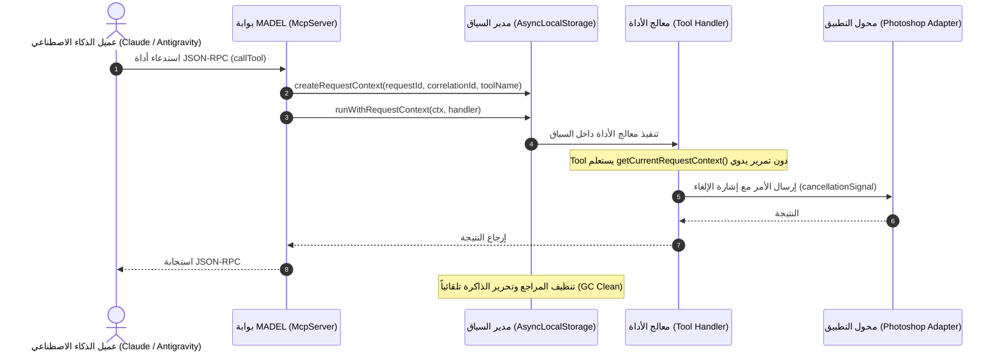

# MADEL Studio Bridge — معمارية سياق الطلب (Request Context Architecture)
**المشروع:** MADEL Studio Bridge — Phase P17  
**المالك والمهندس المشرف:** Mahmoud Adel — محمود عادل  
**المسار المصدري:** `packages/server/src/gateway/context.ts`  
**تاريخ التوثيق:** 10 نوفمبر 2026  
**الحالة:** **PRODUCTION READY & FULLY TESTED**

---

## 1. نظرة عامة (Overview)

في بيئات وكلاء الذكاء الاصطناعي متعددة الجلسات (مثل الربط المتزامن لـ Claude Code و Antigravity و OpenAI Codex عبر بوابة MADEL المركزية)، تنشأ الحاجة الحتمية لتتبع دورة حياة كل طلب (Request Lifecycle) منذ لحظة وصوله وحتى انتهاء تنفيذه أو إلغائه.

تم بناء نظام **Request Context** في منصة MADEL Studio Bridge بالاعتماد الكامل على مكتبة Node.js القياسية المدمجة `node:async_hooks` من خلال `AsyncLocalStorage`، دون أي تبعيات خارجية، مما يضمن أداءً فائقاً (Zero Runtime Overhead) وعزلاً تاماً للبيانات بين فروع الاستدعاء غير المتزامنة (Asynchronous Execution Trees).

---

## 2. بنية سياق الطلب (Context Data Structure)

لكل طلب يتم استقباله عبر قنوات Stdio أو Named Pipe أو WebSocket، يتم إنشاء كائن سياق غير قابل للتعديل (`RequestContext`):

```typescript
export interface RequestContext {
  readonly requestId: string;            // معرف فريد للطلب (UUIDv4)
  readonly correlationId: string;        // معرف الارتباط لتتبع مسار الطلب عبر المنظومة
  readonly clientId: string;             // هوية العميل المتصل (antigravity, claude-code, codex...)
  readonly applicationId: string;        // التطبيق المستهدف (photoshop, blender, premiere...)
  readonly toolName: string;             // اسم أداة MCP المستدعاة (ps_create_document...)
  readonly startedAt: number;            // الطابع الزمني لبدء الطلب (Epoch ms)
  readonly deadline?: number;            // موعد الانتهاء الأقصى للطلب (startedAt + timeoutMs)
  readonly abortController: AbortController; // وحدة التحكم بالإلغاء
  readonly cancellationSignal: AbortSignal;  // إشارة الإلغاء المرتبطة
  readonly metadata: Readonly<Record<string, unknown>>; // بيانات وصفية منقحة
}
```

---

## 3. حماية البيانات والخصوصية الصارمة (Sanitization & Privacy Gate)

لحماية أمان النظام وخصوصية المطور والعملاء، يطبق سياق الطلب سياسة حجب وتطهير إجبارية للمعلومات الحساسة. لا يتم إدراج أو تخزين أو تسجيل أي من البيانات التالية تحت أي ظرف:
- مفاتيح الواجهات البرمجية (API Keys).
- التوكنات وتوكنات المصادقة (Bearer Tokens, Auth Tokens).
- كلمات المرور والبيانات السرية (Passwords, Secrets).
- المحتوى الخام لوثائق المستخدم والمشاريع الشخصية.

أي حقل يحمل اسماً حساساً (مثل `token`, `secret`, `password`, `apikey`, `authorization`) يتم حجبه تلقائياً وتحويل قيمته إلى `[REDACTED]`.

---

## 4. دورة الحياة وآلية العمل (Lifecycle & Execution Flow)



---

## 5. تكامل الأدوات القديمة والتوافقية الكاملة (Backward Compatibility)

تم ربط سياق الطلب بنظام `withToolContext` في `packages/server/src/tools/call-context.ts`، بحيث:
1. تظل الدالة القديمة `currentToolCall()` تعمل بكامل طاقتها لإرجاع اسم الأداة والوسائط لأغراض إثراء الأخطاء التشخيصية.
2. تتوفر الدوال الجديدة عالمياً في أي مكان عبر سلسلة الـ Async:
   - `getCurrentRequestContext()`: جلب السياق الحالي.
   - `getCorrelationId()`: جلب معرّف الارتباط للطلب الحالي (أو توليد معرّف بديل عند عدم وجود سياق).
   - `getRequestAbortSignal()`: جلب إشارة الإلغاء للربط مع العمليات الشبكية أو استدعاءات العمليات الفرعية.
   - `isRequestCancelled()`: التحقق الفوري مما إذا كان الطلب قد تم إلغاؤه من قبل العميل.
