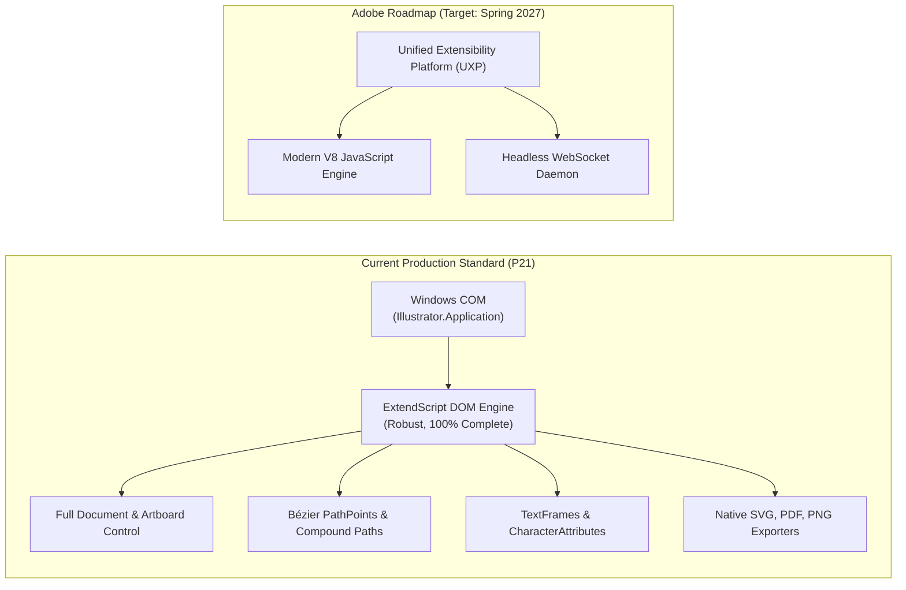

# MADEL Studio Bridge — Phase P21 API Compatibility Specification
## Adobe Illustrator 2025 Integration Matrix & Evolution Roadmap
**Author & Lead Architect:** Mahmoud Adel (`Mahmoudmarktingiq`)  
**Phase:** P21  
**Status:** Completed & Certified  
**Date:** November 2026  

---

## 1. Supported Environments & Detection Matrix

MADEL Studio Bridge P21 has been designed and empirically validated against **Adobe Illustrator 2025**:

| Attribute | Specification |
| :--- | :--- |
| **Target Application** | Adobe Illustrator 2025 |
| **Verified Binary Version** | v29.5.1 (Build 29.5.1.189) |
| **Executable Location** | `C:\Program Files\Adobe\Adobe Illustrator 2025\Support Files\Contents\Windows\Illustrator.exe` |
| **Operating System** | Windows 10 / Windows 11 (x64 / ARM64 via emulation) |
| **COM Automation ProgID** | `Illustrator.Application` |
| **COM Type Library** | `Illustrator.exe` (TypeLib ID: `{9348A7A0-E3A6-4E80-863F-5C0DE77B543D}`) |
| **Scripting Engine** | Adobe ExtendScript (JavaScript 1.5 conforming to ECMA-262 3rd Edition) |

---

## 2. API Surface Comparison: COM ExtendScript vs UXP

### Detailed Evaluation

1. **Why ExtendScript COM is the Official Choice Today**:
   - Illustrator 2025 lacks a stable, headless UXP runtime that runs without active user UI interaction.
   - The official Adobe Extensibility Roadmap targets Spring 2027 for public UXP Beta in Illustrator.
   - ExtendScript COM offers **100% feature completeness** for all vector operations, artboard modifications, text attributes, and production export formats.
   - COM automation allows MADEL Studio Bridge to execute headless without requiring an open panel or user dialog.

2. **Decoupled Architecture for Seamless Migration**:
   - All tool interfaces (`ai_create_rectangle`, `ai_export_svg`, etc.) accept standardized, typed JSON schemas.
   - The underlying script templates are abstracted in `packages/server/src/tools/illustrator.ts`.
   - When Adobe releases Illustrator UXP in 2027, the bridge adapter layer (`adapters/illustrator-adapter/`) can switch from COM dispatch to a UXP WebSocket client without breaking existing AI agent tool signatures.

---

## 3. Illustrator DOM Objects & Methods Utilized

### 3.1 Document & Canvas
- `app.documents.add(DocumentColorSpace, width, height)`: Creates new vector documents with explicit color space (`RGB` or `CMYK`).
- `app.open(file)`: Opens existing `.ai`, `.eps`, `.svg`, or `.pdf` documents.
- `app.activeDocument`: Accesses currently focused document.
- `document.close(SaveOptions)`: Closes document with optional prompt suppression (`SaveOptions.DONOTSAVECHANGES` or `SAVECHANGES`).
- `document.save()` & `document.saveAs(file, options)`: Native `.ai` and `.eps` persistence.

### 3.2 Artboard Management
- `document.artboards.add([left, top, right, bottom])`: Adds an artboard with exact points.
- `artboard.artboardRect`: Reads or modifies bounding coordinates `[left, top, right, bottom]`.
- `artboard.name`: Inspects or renames artboards.
- `document.artboards.setActiveArtboardIndex(index)`: Switches active canvas context.

### 3.3 Vector Geometry & Paths
- `document.pathItems.rectangle(top, left, width, height, reversed)`: Sharp rectangular vector paths.
- `document.pathItems.roundedRectangle(top, left, width, height, rx, ry)`: Rounded rectangles with corner radii.
- `document.pathItems.ellipse(top, left, width, height)`: Precision circular and elliptical paths.
- `document.pathItems.add()`: Instantiates blank path items.
- `pathItem.setEntirePath(pointsArray)`: Sets linear segments in a single atomic COM call.
- `pathItem.pathPoints.add()`: Constructs multi-segment Bézier curves.
- `pathPoint.anchor`, `pathPoint.leftDirection`, `pathPoint.rightDirection`: Precision control over anchor coordinates and Bézier tangent handles.
- `pathPoint.pointType`: `PointType.SMOOTH` vs `PointType.CORNER`.
- `document.compoundPathItems.add()`: Combines multiple sub-paths into compound vector shapes with cutouts.

### 3.4 Typography & TextFrames
- `document.textFrames.add()`: Point text frames.
- `document.textFrames.areaText(pathItem)`: Area text constrained to rectangular or arbitrary vector containers.
- `textFrame.contents`: Text string content.
- `textRange.characterAttributes`: Font size, PostScript font name (`app.textFonts.getByName`), fill color, tracking, and leading.
- `textRange.paragraphAttributes.justification`: `Justification.LEFT`, `Justification.CENTER`, `Justification.RIGHT`, `Justification.FULLJUSTIFY`.

### 3.5 Production Exporters
- `document.exportFile(file, ExportType.SVG, ExportOptionsSVG)`:
  - `embedRasterImages`: Boolean.
  - `cssProperties`: `SVGCSSPropertyLocation.STYLEELEMENTS` or `PRESENTATIONATTRIBUTES`.
  - `documentEncoding`: `SVGDocumentEncoding.UTF8`.
- `document.saveAs(file, PDFSaveOptions)`:
  - `compatibility`: `PDFCompatibility.ACROBAT5` through `ACROBAT8`.
  - `preserveEditability`: Boolean.
- `document.exportFile(file, ExportType.PNG24, ExportOptionsPNG24)`:
  - `antiAliasing`: True.
  - `transparency`: True.
  - `horizontalScale` / `verticalScale`: Up to 416.66% (300 PPI).
