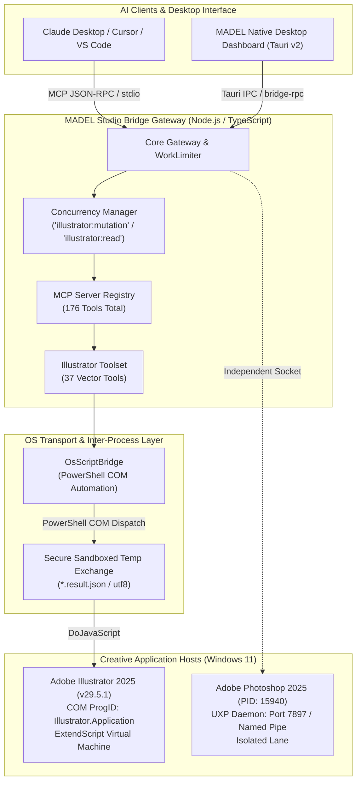

# MADEL Studio Bridge — Phase P21 Architecture Specification
## Adobe Illustrator MCP Integration: Vectors, Artboards & SVG
**Author & Lead Architect:** Mahmoud Adel (`Mahmoudmarktingiq`)  
**Phase:** P21  
**Status:** Completed & Certified  
**Date:** November 2026  

---

## 1. Executive Summary & Architectural Goals

Phase P21 introduces production-grade Adobe Illustrator automation into **MADEL Studio Bridge**, expanding the platform's multi-application creative suite beyond raster and composition workflows into precision 2D vector graphics, typography, artboard management, and standards-compliant SVG/PDF generation.

### Core Architectural Pillars
1. **Decoupled Adapter Layer**: Architecture cleanly separated into `adapters/illustrator-adapter/` and `packages/server/src/tools/illustrator.ts`.
2. **Deterministic Dual-Lane Isolation**: Zero port or process overlap with the Photoshop UXP Daemon running on TCP `127.0.0.1:7897` and Named Pipe `\\.\pipe\madel-photoshop-pipe` (PID 15940).
3. **ExtendScript COM Pipeline**: Robust automation through native Windows Component Object Model (ProgID `Illustrator.Application.DoJavaScript`) with file-backed JSON transport and UTF-8 error handling.
4. **Future-Proof UXP Pathway**: Abstracted script generation enabling zero-breakage migration when Adobe releases Illustrator UXP (targeted Spring 2027).
5. **Gateway Concurrency & Scoping**: Fine-grained concurrency isolation via `WorkLimiter` separating `illustrator:read` (timeout 30s) and `illustrator:mutation` (timeout 60s).

---

## 2. System Architecture Diagram

---

## 3. Communication Transport & Script Execution Engine

### 3.1 COM Automation vs Socket Daemons
While Adobe Photoshop utilizes an in-process UXP WebSockets plugin daemon, Adobe Illustrator 2025 does not currently provide a native headless UXP WebSockets server. To guarantee maximum reliability on Windows without requiring manual user intervention or third-party background services:
- **Transport Mechanism**: Windows COM via `ActiveXObject` / `[Type]::GetTypeFromProgID('Illustrator.Application')`.
- **Execution Vector**: `app.doJavaScript(script)`.
- **Payload Wrapping**: All scripts execute inside an anonymous self-executing function `(function() { ... })()`.
- **Telemetry Extraction**: Results are serialized using native ExtendScript JSON serializers into typed objects, written to atomic temporary result files, and parsed by `OsScriptBridge`.

### 3.2 Dual-Lane Independence
| Application | Transport Lane | Port / Socket | Concurrency Scope | Timeout |
| :--- | :--- | :--- | :--- | :--- |
| **Photoshop 2025** | UXP WebSocket / Named Pipe | Port 7897 / `\\.\pipe\madel-photoshop-pipe` | `photoshop:mutation` / `read` | 60s / 30s |
| **Illustrator 2025** | OS COM Automation | Windows COM / Out-of-process | `illustrator:mutation` / `read` | 60s / 30s |
| **After Effects** | WebSocket Protocol v2 | Ephemeral Port (65004+) | `after_effects:render` | 120s |
| **Premiere Pro** | Dynamic Link / COM (P22) | Planned (P22) | `premiere:mutation` | 60s |

---

## 4. Concurrency & Lifetime Policy

Illustrator's COM interface is single-threaded and modal at the application DOM level. Executing concurrent calls simultaneously causes COM busy errors (`0x8001010A RPC_E_SERVERCALL_RETRYLATER`).

To prevent collisions:
1. **Serialization**: `WorkLimiter` assigns a concurrency limit of `1` for all Illustrator tasks.
2. **FIFO Scheduling**: Tasks are strictly queued in order of arrival with request IDs propagated across async boundaries.
3. **Backpressure Guard**: Maximum queue depth is limited to 50 requests; subsequent incoming requests are rejected immediately with `503 Server Busy`.
4. **Timeout Enforcement**:
   - Mutation tools (`ai_create_*`, `ai_export_*`): 60,000 ms.
   - Read tools (`ai_list_*`, `ai_get_document_info`): 30,000 ms.

---

## 5. Architectural Quality Attributes

- **Resilience**: Script evaluation failures do not terminate the server process. Extended errors are caught within the JSX scope and returned as structured JSON error frames.
- **Maintainability**: Parameter validation is separated from JSX templating. All JSX generation is encapsulated in pure helper functions (`createDocScript`, `createPathScript`, `exportSvgScript`).
- **Auditability**: Every mutation script is hashed and recorded with a SHA-256 identifier in the diagnostic audit log.
