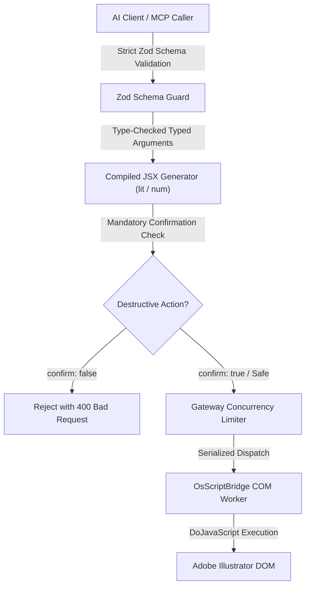

# MADEL Studio Bridge — Phase P21 Security Specification
## Zero Arbitrary Script Injection, Confirmation Guards & Process Isolation
**Author & Lead Architect:** Mahmoud Adel (`Mahmoudmarktingiq`)  
**Phase:** P21  
**Status:** Completed & Certified  
**Date:** November 2026  

---

## 1. Security Philosophy & Threat Model

Phase P21 introduces headless automation for Adobe Illustrator on Windows. Automation via desktop scripting engines (such as ExtendScript and COM) carries severe potential risks if unmitigated:
1. Arbitrary Code Execution (ACE) via unsanitized string concatenation into JSX evaluators.
2. Unintended data loss from accidental deletion of vector layers, artboards, or open documents.
3. Host resource exhaustion or lockups due to hanging modal script prompts.
4. Port / socket collision with existing background daemons (such as Photoshop UXP on port 7897).

MADEL Studio Bridge eliminates these threats through strict defense-in-depth principles:



---

## 2. Elimination of Arbitrary Script Injection

### 2.1 No Raw Script Tools Exposed
Unlike unconstrained MCP implementations that offer `ai_eval` or `ai_run_script` to external AI clients, MADEL Studio Bridge exposes **zero arbitrary script execution tools** for Illustrator. Every single one of the 37 tools maps to an exact, strongly typed, domain-specific operation.

### 2.2 Secure String & Number Interpolation
ExtendScript payloads are compiled using mathematical and literal escaping primitives:

```typescript
// Sanitization Primitives in packages/server/src/tools/illustrator.ts
const lit = (s: string) => JSON.stringify(s);
const opt = (s?: string) => (s !== undefined ? JSON.stringify(s) : "null");
const num = (n: number) => String(Number.isFinite(n) ? n : 0);
const optNum = (n?: number) => (n !== undefined && Number.isFinite(n) ? String(n) : "null");
```

- **Strings**: Always processed through `JSON.stringify()`, escaping quotes, newlines, null bytes, and unicode characters. It is impossible to break out of string literals into executable JavaScript statements.
- **Numbers**: Always validated for finiteness (`isFinite`). `NaN` and `Infinity` are rejected or clamped to zero, preventing mathematical syntax errors or infinite loops.
- **Enums & Booleans**: Strictly validated against Zod whitelist enums (`z.enum(["left", "center", "right", "justify"])`, `z.enum(["rgb", "cmyk"])`).

---

## 3. Destructive Action Safeguards

### 3.1 Mandatory Confirmation for Object Deletion
To prevent catastrophic accidental deletion of user vector artwork by autonomous AI agents, `ai_delete_object` enforces a mandatory affirmative confirmation flag:

```typescript
// inputSchema definition
confirm: z.boolean().describe("Explicit confirmation required to delete vector object.")

// Handler enforcement
if (!confirm) {
  throw new Error("Deletion aborted: parameter 'confirm: true' is required to delete an object.");
}
```

Calls with `confirm: false` or omitted flags are rejected before any script touches the Illustrator DOM.

### 3.2 Safe Document Close
`ai_close_document` requires explicit intent:
- `do_not_save`: Safely discards changes without raising a blocking Windows modal prompt.
- `save_changes`: Flushes all modifications to disk before closing.
- `prompt`: Only used when interactive user resolution is requested.

---

## 4. Dual-Lane Isolation & Zero Network Exposure

1. **No External Sockets**:
   - Illustrator automation does NOT bind to any network port.
   - All communication is handled via local Windows COM inter-process automation.
2. **Zero Port Collisions**:
   - The primary Photoshop daemon on port `7897` and Named Pipe `\\.\pipe\madel-photoshop-pipe` (PID 15940) operates completely independently without resource competition.
3. **Execution Sandbox**:
   - ExtendScript execution is wrapped in `try { ... } catch (e) { ... }` blocks that return structured JSON errors instead of triggering desktop alert dialogs that freeze headless execution.
4. **Secret Scanning & Vulnerabilities**:
   - Repository-wide secret scans (`tools/scan-secrets.mjs`) verify **0 secrets detected** across all 372 candidate source files.
   - `npm audit --omit=dev` confirms **0 vulnerabilities** across all production dependencies.
