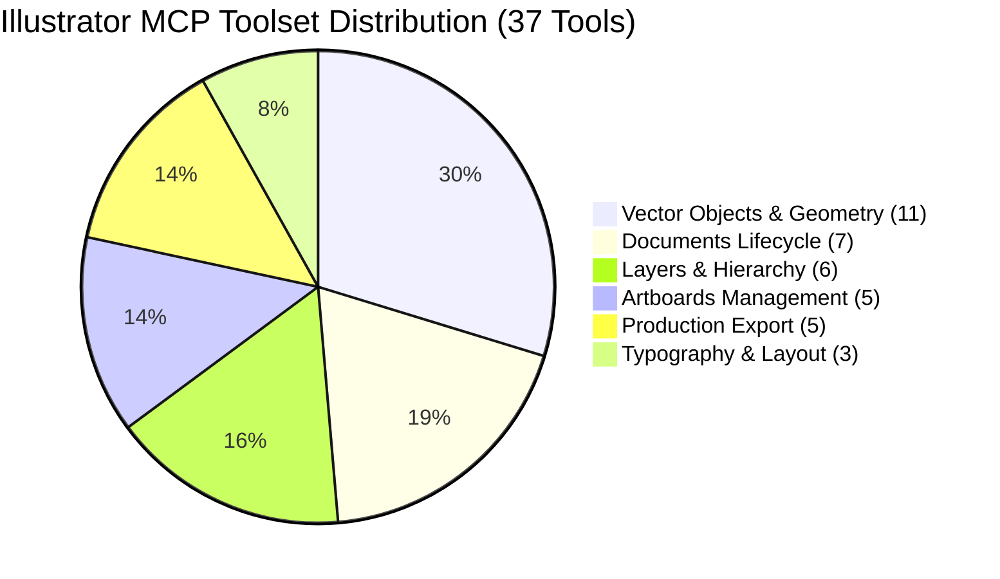

# MADEL Studio Bridge — Phase P21 Tool Registry
## Complete Catalog of 37 Adobe Illustrator MCP Tools
**Author & Lead Architect:** Mahmoud Adel (`Mahmoudmarktingiq`)  
**Phase:** P21  
**Status:** Completed & Certified  
**Date:** November 2026  

---

## 1. Overview of Tools

The MADEL Studio Bridge Adobe Illustrator integration exposes **37 specialized MCP tools** categorized into 6 functional domains. Every tool is strictly typed via Zod v4 schemas, validated at the wire boundary, wrapped in error guards, and assigned to the deterministic Gateway Concurrency Manager.

---

## 2. Category 1: Document Lifecycle Management (7 Tools)

| Tool Name | Scope | Description | Primary Parameters |
| :--- | :--- | :--- | :--- |
| `ai_list_documents` | `illustrator:read` | Returns array of all currently open Illustrator documents. | None |
| `ai_get_document_info` | `illustrator:read` | Retrieves full document telemetry (dimensions in pt/mm/in, artboards, layers, page items, color space). | None |
| `ai_create_document` | `illustrator:mutation` | Creates a new vector document with customizable units and color mode. | `width`, `height`, `units` (`pt`/`mm`/`in`), `colorMode` (`rgb`/`cmyk`), `name` |
| `ai_open_document` | `illustrator:mutation` | Opens an existing document from an absolute filesystem path. | `path` |
| `ai_save_document` | `illustrator:mutation` | Saves the currently active document to its current file path. | None |
| `ai_save_as` | `illustrator:mutation` | Saves the document to a target path with specified format. | `path`, `format` (`ai`/`eps`) |
| `ai_close_document` | `illustrator:mutation` | Closes the active document safely. | `save` (`save_changes`/`do_not_save`/`prompt`) |

---

## 3. Category 2: Artboard Management (5 Tools)

| Tool Name | Scope | Description | Primary Parameters |
| :--- | :--- | :--- | :--- |
| `ai_list_artboards` | `illustrator:read` | Lists all artboards with index, name, bounds, and active flag. | None |
| `ai_create_artboard` | `illustrator:mutation` | Adds a new artboard with specified dimensions and position. | `width`, `height`, `x`, `y`, `name` |
| `ai_resize_artboard` | `illustrator:mutation` | Resizes and optionally repositions an artboard by index. | `width`, `height`, `artboardIndex`, `x`, `y` |
| `ai_rename_artboard` | `illustrator:mutation` | Renames an artboard at a specified index or active artboard. | `name`, `artboardIndex` |
| `ai_set_active_artboard` | `illustrator:mutation` | Switches the active artboard index. | `artboardIndex` |

---

## 4. Category 3: Vector Objects & Bézier Geometry (11 Tools)

| Tool Name | Scope | Description | Primary Parameters |
| :--- | :--- | :--- | :--- |
| `ai_create_rectangle` | `illustrator:mutation` | Draws a rectangle with optional rounded corners. | `x`, `y`, `width`, `height`, `cornerRadius`, `fill`, `stroke`, `strokeWidth`, `name` |
| `ai_create_ellipse` | `illustrator:mutation` | Draws an ellipse or circle. | `x`, `y`, `width`, `height`, `fill`, `stroke`, `strokeWidth`, `name` |
| `ai_create_line` | `illustrator:mutation` | Draws a straight vector line segment. | `x1`, `y1`, `x2`, `y2`, `stroke`, `strokeWidth`, `name` |
| `ai_create_path` | `illustrator:mutation` | Constructs an arbitrary Bézier path with anchor points and handles. | `points` (array of `{x, y, inHandle, outHandle, pointType}`), `closed`, `fill`, `stroke`, `strokeWidth`, `name` |
| `ai_create_compound_path` | `illustrator:mutation` | Groups multiple named paths into a compound shape. | `pathNames` (array), `fill`, `stroke`, `strokeWidth`, `name` |
| `ai_move_object` | `illustrator:mutation` | Translates a named object by delta dx, dy in canvas points. | `name`, `dx`, `dy` |
| `ai_resize_object` | `illustrator:mutation` | Scales a named object by percentage. | `name`, `scaleX`, `scaleY`, `changePositions`, `changeFillPatterns`, `changeFillGradients`, `changeStrokePattern`, `changeLineWidths` |
| `ai_rotate_object` | `illustrator:mutation` | Rotates a named object by specified angle in degrees. | `name`, `angle` |
| `ai_duplicate_object` | `illustrator:mutation` | Duplicates a named object with optional offset and rename. | `name`, `newName`, `dx`, `dy` |
| `ai_delete_object` | `illustrator:mutation` | Deletes a named object with mandatory safety guard. | `name`, `confirm: true` |
| `ai_create_shape` | `illustrator:mutation` | Legacy backward-compatible parametric shape creator. | `type` (`rectangle`/`oval`/`line`), `x`, `y`, `width`, `height`, `fillColor` |

---

## 5. Category 4: Layers & Hierarchical Grouping (6 Tools)

| Tool Name | Scope | Description | Primary Parameters |
| :--- | :--- | :--- | :--- |
| `ai_list_layers` | `illustrator:read` | Returns all document layers with visibility and lock state. | None |
| `ai_create_layer` | `illustrator:mutation` | Creates a new layer with name and placement options. | `name`, `below` (boolean) |
| `ai_rename_layer` | `illustrator:mutation` | Renames an existing layer. | `oldName`, `newName` |
| `ai_group_objects` | `illustrator:mutation` | Groups multiple named items into a new group item. | `objectNames` (array), `groupName` |
| `ai_ungroup_objects` | `illustrator:mutation` | Ungroups items inside a named group. | `groupName` |
| `ai_set_layer_props` | `illustrator:mutation` | Sets layer visibility, lock status, and opacity. | `layerName`, `visible`, `locked`, `opacity` |

---

## 6. Category 5: Typography & Paragraph Layout (3 Tools)

| Tool Name | Scope | Description | Primary Parameters |
| :--- | :--- | :--- | :--- |
| `ai_create_text` | `illustrator:mutation` | Creates point text or constrained area text. | `text`, `x`, `y`, `fontSize`, `font`, `fill`, `stroke`, `strokeWidth`, `width`, `height`, `alignment`, `name` |
| `ai_update_text` | `illustrator:mutation` | Modifies text content, font family, size, or fill color. | `name`, `text`, `fontSize`, `font`, `fill`, `alignment` |
| `ai_set_text_alignment` | `illustrator:mutation` | Updates paragraph justification. | `name`, `alignment` (`left`/`center`/`right`/`justify`) |

---

## 7. Category 6: Production Export & Preview (5 Tools)

| Tool Name | Scope | Description | Primary Parameters |
| :--- | :--- | :--- | :--- |
| `ai_export_svg` | `illustrator:mutation` | Exports document or artboard to clean SVG. | `path`, `artboardIndex`, `embedRasterImages`, `cssLocation` (`style_elements`/`presentation_attributes`) |
| `ai_export_pdf` | `illustrator:mutation` | Exports vector PDF with Acrobat compatibility. | `path`, `compatibility` (`acrobat5`..`acrobat8`), `preserveEditability` |
| `ai_export_png` | `illustrator:mutation` | Exports high-resolution raster image up to 300 PPI. | `path`, `resolution` (72..300), `transparency`, `artboardIndex` |
| `ai_save_as_ai` | `illustrator:mutation` | Saves native Adobe Illustrator (.ai) file. | `path`, `compatibility` (`illustrator10`..`illustrator2020`) |
| `ai_export_artboard` | `illustrator:mutation` | Exports a specific artboard to PNG/JPG/SVG. | `artboardIndex`, `path`, `format` (`png`/`jpeg`/`svg`) |
| `ai_get_preview` | `illustrator:read` | Renders and captures a fast preview frame. | `artboardIndex` |
