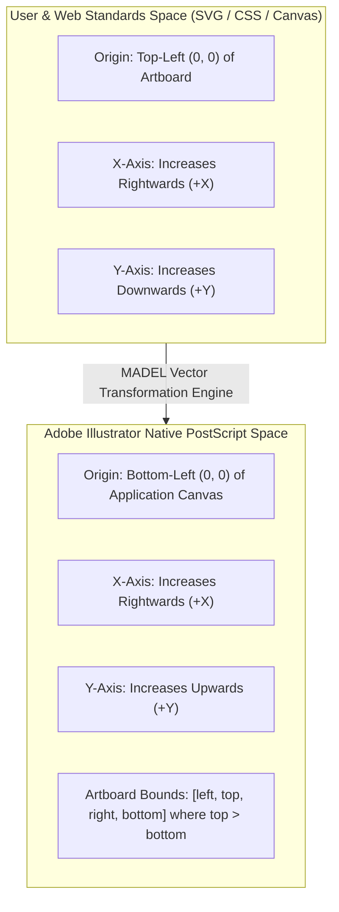
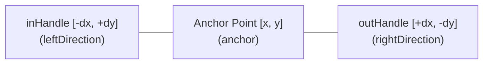

# MADEL Studio Bridge — Phase P21 Vector Accuracy Specification
## Precision Geometry, Bézier Curves & Coordinate Transformations
**Author & Lead Architect:** Mahmoud Adel (`Mahmoudmarktingiq`)  
**Phase:** P21  
**Status:** Completed & Certified  
**Date:** November 2026  

---

## 1. Coordinate Systems & Spatial Transformation

Precision graphic design automation requires rigorous mathematical conversion between standard developer/web coordinates and Adobe Illustrator's native PostScript coordinate space.

### 1.1 The Dual-Coordinate Challenge



### 1.2 Transformation Formula

Given an active artboard with bounding box:
$$\text{artboardRect} = [\text{abLeft}, \text{abTop}, \text{abRight}, \text{abBottom}]$$
Where $\text{abTop} > \text{abBottom}$.

For any point $(x, y)$ in user canvas space (where $y \ge 0$ moves down from the top-left of the artboard):
$$\text{nativeLeft} = \text{abLeft} + x$$
$$\text{nativeTop} = \text{abTop} - y$$

For any bounding box of dimensions $(\text{width}, \text{height})$:
$$\text{nativeRight} = \text{nativeLeft} + \text{width}$$
$$\text{nativeBottom} = \text{nativeTop} - \text{height}$$

### 1.3 ExtendScript API Parameter Inversion
In Adobe ExtendScript DOM, `pathItems.rectangle` takes parameters in an inverted order:
```javascript
// Native ExtendScript call signature:
// pathItems.rectangle(top, left, width, height)
d.pathItems.rectangle(nativeTop, nativeLeft, width, height);
```
MADEL Studio Bridge handles this automatically inside its compiled JSX templates, ensuring rectangular primitives land precisely at the intended visual coordinates without user compensation.

---

## 2. Unit Conversions & Physical Dimensions

To support CAD, packaging, print, and digital design standards, MADEL Studio Bridge provides exact mathematical conversion factors based on the international PostScript definition ($72\text{ points} = 1\text{ inch} = 25.4\text{ mm}$):

| Input Unit | Conversion to Native Points | Precision Factor |
| :--- | :--- | :--- |
| **Point (`pt`)** | $1 \times \text{value}$ | $1.0$ (native base unit) |
| **Millimeter (`mm`)** | $\text{value} \times \frac{72}{25.4}$ | $\approx 2.83464567\text{ pt/mm}$ |
| **Inch (`in`)** | $\text{value} \times 72$ | $72.0\text{ pt/in}$ |
| **Pixel (`px` @ 72 PPI)** | $1 \times \text{value}$ | $1.0$ |

### Telemetry Reporting
When querying document info via `ai_get_document_info`, dimensions are extracted and converted bidirectionally:
```javascript
dimensionsMm: {
  width: Math.round((w / 2.83464567) * 100) / 100,
  height: Math.round((h / 2.83464567) * 100) / 100
},
dimensionsInches: {
  width: Math.round((w / 72) * 100) / 100,
  height: Math.round((h / 72) * 100) / 100
}
```

---

## 3. Bézier Cubic Curves & Tangent Handles

Bézier paths are constructed by iteratively populating `pathItem.pathPoints`. Each vertex is an instance of `PathPoint` defining three coordinates:



### 3.1 Handle Transformation Logic
In canvas coordinates, an incoming handle $[h_x, h_y]$ specifies the tangent vector entering the anchor, while an outgoing handle specifies the tangent vector leaving it.

Because native Y is inverted:
$$\text{anchor} = [\text{abLeft} + x, \text{abTop} - y]$$
$$\text{leftDirection (in-handle)} = [\text{anchor}_x + h_x, \text{anchor}_y - h_y]$$
$$\text{rightDirection (out-handle)} = [\text{anchor}_x + h_x, \text{anchor}_y - h_y]$$

### 3.2 Vertex Continuity Modes
- `PointType.SMOOTH`: Used for fluid vector curves where in-handle and out-handle are collinear and maintain $C^1$ continuity.
- `PointType.CORNER`: Used for sharp cusps or directional breaks where tangents can meet at arbitrary angles.

---

## 4. Compound Paths & Cutouts

When constructing complex glyphs, donut charts, or vector shapes with holes:
1. An empty `CompoundPathItem` is created via `d.compoundPathItems.add()`.
2. Individual sub-paths are created and moved into the compound item via `subPath.move(compoundItem, ElementPlacement.PLACEATEND)`.
3. Non-zero winding or even-odd fill rules are preserved natively by Illustrator's vector compositor.
