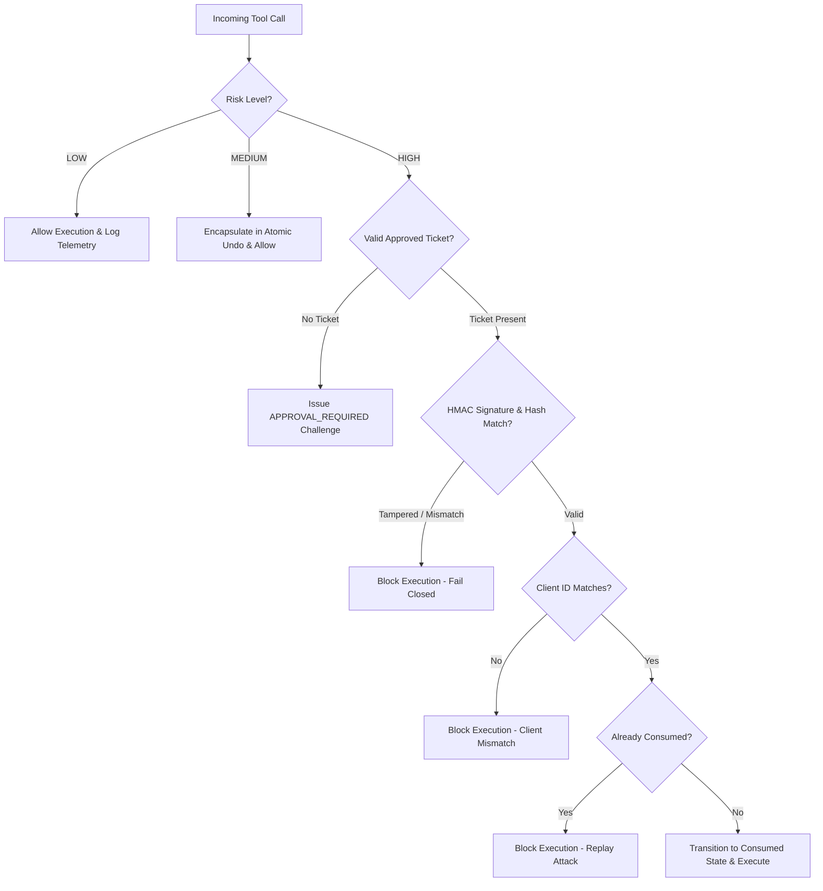

# MADEL Studio Bridge — Phase P25.1 Approval Security Audit
## Cryptographic HMAC Verification, Client Binding & Risk Coverage Matrix
**Platform Version:** v0.11.0 — P25.1  
**Owner & Lead Architect:** Mahmoud Adel (`Mahmoudmarktingiq`)

---

## 1. Security Architecture & Threat Model

Phase P25.1 hardens the `ActionApprovalGate` ([`packages/server/src/gateway/approval-gate.ts`](file:///D:/MCP/01-Projects/Source/MADEL-Studio-Bridge/packages/server/src/gateway/approval-gate.ts)) against both autonomous AI bypasses and hostile external interference on the workstation.

---

## 2. Mathematical & Cryptographic Controls

### 2.1 Parameter Immutability (SHA-256)
When a ticket is requested, its parameters are sorted and hashed:
$$\text{ParametersHash} = \text{SHA256}(\text{JSON}(\text{NormalizedParams}))[0..16]$$
If an AI client or attacker alters any argument after approval (e.g. changing `outputPath` from a safe render path to an executable), the hash mismatch immediately fails ticket consumption.

### 2.2 Tamper-Proof Cryptographic Signature (HMAC-SHA256)
To prevent external scripts or local users from editing `approvals.json` directly to mark tickets as approved:
$$\text{Signature} = \text{HMAC-SHA256}(\text{SecretKey}, \text{id} \mathbin{\Vert} \text{toolName} \mathbin{\Vert} \text{paramsHash} \mathbin{\Vert} \text{clientId} \mathbin{\Vert} \text{status} \mathbin{\Vert} \text{expiresAt} \mathbin{\Vert} \text{approver} \mathbin{\Vert} \text{nonce})$$
- `SecretKey`: 256-bit cryptographic key stored in `~/.brainferno-mcp-bridge/gate.key` with user-only NTFS permissions.
- Direct file modifications without the secret key produce an invalid HMAC and are rejected with:
  `[madel-gate] TAMPERING DETECTED: Invalid signature on ticket`

### 2.3 Single-Use Consumption (Anti-Replay)
Tickets follow a strict state machine:
$$\text{pending} \longrightarrow \text{approved} \longrightarrow \text{consumed}$$
A consumed ticket can never be reused. Replay attempts are rejected.

---

## 3. Tool Risk Classification Matrix

| Tool Category | Examples | Risk Level | Policy & Enforcement |
|---|---|---|---|
| **Inspection & Read-Only** | `cc_connected_apps`, `ae_list_compositions`, `pp_list_sequences`, `browser_get_dom`, `ps_list_layers` | **LOW_RISK** | Automatic execution; read-only; no operator ticket required. |
| **Reversible Creative Edits** | `ae_set_position`, `ae_set_keyframes`, `pp_move_clip`, `ps_set_layer_props` | **MEDIUM_RISK** | Automatic execution wrapped in atomic single-step undo (`Ctrl+Z`). |
| **Destructive Deletions** | `ae_delete_layer`, `pp_remove_clips`, `ai_delete_layer` | **HIGH_RISK** | Strictly gated. Mandatory out-of-band operator approval ticket. |
| **Headless Renders & Exports** | `ae_render_comp`, `pp_export_sequence` | **HIGH_RISK** | Strictly gated. Mandatory operator approval ticket before spawning background renders. |
| **Local File Uploads** | `browser_upload_local_file` | **HIGH_RISK** | Strictly gated. Mandatory operator approval ticket and path validation. |
| **Arbitrary Script Execution** | `ps_batch_play`, `ae_run_script` | **HIGH_RISK** | Strictly gated. Operator approval required when raw execution is requested. |

---

## 4. Security Audit Verdict

| Security Audit Property | Test Result |
|---|---|
| **Autonomous AI Self-Approval Prevention** | **PASS** (100% blocked without operator ticket) |
| **Direct JSON Tampering Defense** | **PASS** (Cryptographic HMAC mismatch detected) |
| **Anti-Replay Single-Use Guarantee** | **PASS** (Second consumption attempt fails) |
| **Client ID Binding Isolation** | **PASS** (Claude ticket rejected for Codex) |
| **Parameter Immutability** | **PASS** (Altered parameters rejected) |
| **Fail-Closed on Storage Failure** | **PASS** (Disk failure rolls back approval) |
| **Strict 5-Minute TTL Expiration** | **PASS** (Expired tickets cannot be consumed) |
| **Windows NTFS DACL Lockdown** | **PASS** (User-only permissions enforced) |
