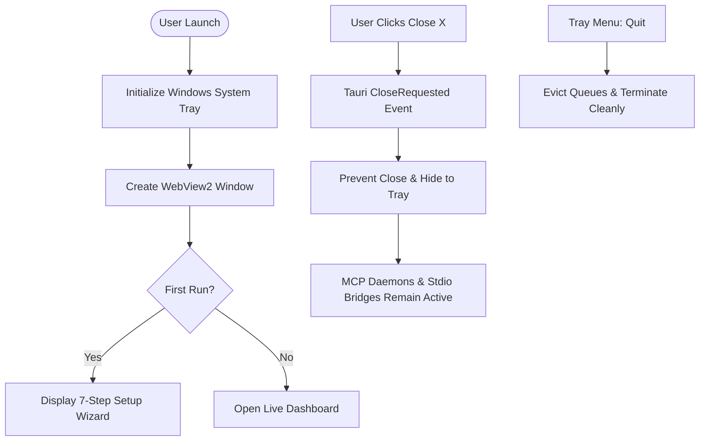

# MADEL Studio Bridge — Phase P25 Architecture Specification
## Windows Desktop Installer & Production Packaging Architecture
**Platform Version:** v0.11.0  
**Owner & Lead Architect:** Mahmoud Adel (`Mahmoudmarktingiq`)  
**Target Environment:** Windows 10/11 x64 (Standard User Context & Per-User Isolation)

---

## 1. Architectural Overview

Phase P25 transitions MADEL Studio Bridge from a local developer workspace into an installable, standalone Windows Desktop platform. It combines:
1. **Tauri v2 Native Host**: High-performance Rust binary (`madel-desktop.exe`) managing the Windows WebView2 lifecycle, system tray notifications, window state, and secure local IPC.
2. **Vue 3 + Pinia + TypeScript Frontend**: Modern Fluent-style UI providing live concurrency metrics, application detection, AI client configurations, real-time activity audit streams, and an interactive 7-step Setup Wizard.
3. **Decoupled Backend Resource Bundle**: Compiled Node.js backend runtime packaged within the application's private resource directory (`resources/server/dist/`), completely decoupled from development paths (`D:\MCP\01-Projects\...`).
4. **Out-of-Band Action Approval Gate**: Cryptographically verified, single-use approval ticket system preventing autonomous AI agents from self-authorizing destructive operations (`ae_delete_layer`, `pp_remove_clips`, `browser_upload_local_file`, `ae_render_comp`).
5. **NSIS (Nullsoft Scriptable Install System) Bundler**: Industry-standard Windows installer delivering per-user clean installations, Start Menu integration, desktop shortcuts, safe updates, and 100% leak-free uninstallation.

---

## 2. Component Distribution & Directory Layout

### Installed Application Hierarchy (`%LOCALAPPDATA%\Programs\MADEL Studio Bridge\`)
```
MADEL Studio Bridge/
├── madel-desktop.exe               # Tauri v2 native executable (Rust + WebView2)
├── uninstall.exe                   # NSIS uninstaller
├── resources/
│   └── server/
│       ├── package.json            # Version and module manifest
│       └── dist/
│           ├── index.js            # MCP Server stdio entrypoint
│           ├── desktop/
│           │   └── bridge-rpc.js   # Desktop JSON-RPC runner
│           ├── gateway/
│           │   ├── approval-gate.js# Action Approval Gate core
│           │   ├── concurrency-manager.js
│           │   └── work-limiter.js
│           ├── clients/            # Declarative AI client managers
│           └── tools/              # 231 MCP tool definitions
└── icons/                          # Application & Tray icons
```

### User Configuration & State Isolation (`%USERPROFILE%\.brainferno-mcp-bridge\`)
```
.brainferno-mcp-bridge/
├── bridge.json                     # Primary daemon handshake (PID, port, auth token)
├── approvals.json                  # Action Approval Gate ticket store (mode 0600)
└── backups/                        # Atomic client configuration backups
```

---

## 3. Decoupled Path & Runtime Resolution

In developer environments, the Rust shell could fall back to `D:\MCP\...` relative paths. In production installations, `find_bridge_rpc_script()` in `commands/mod.rs` evaluates locations strictly in the following priority order:

1. **Explicit Environment Variable**: `std::env::var("MADEL_BRIDGE_PATH")`
2. **Installed Application Resources**: `current_exe().parent().join("resources/server/dist/desktop/bridge-rpc.js")`
3. **Bundled Server Directory**: `current_exe().parent().join("server/dist/desktop/bridge-rpc.js")`
4. **Current Working Directory Resources**: `current_dir().join("resources/server/dist/desktop/bridge-rpc.js")`
5. **Development Fallbacks**: Local relative workspace paths only when running inside Git repo.

### Node.js Executable Resolution (`find_node_binary()`):
1. `std::env::var("MADEL_NODE_PATH")`
2. Embedded portable Node: `current_exe().parent().join("resources/nodejs/node.exe")`
3. Host system PATH resolution: `node` via standard PATH discovery.

---

## 4. Security & Isolation Architecture

### 4.1 Non-Administrator Execution
The installer configures `installMode: "currentUser"`. The desktop application and MCP servers execute entirely within standard user privileges, requiring zero elevated UAC prompts during installation or normal operation.

### 4.2 Out-of-Band Action Approval Gate
Prior to P25, parameters such as `confirm: true` or `approved: true` were supplied by the client. An autonomous AI model could self-supply these parameters without human review. Phase P25 enforces:
- High-risk operations issue an `APPROVAL_REQUIRED` challenge containing a short-lived ticket ID (`appr_...`).
- The ticket parameter hash (SHA-256) is recorded and locked.
- Operator reviews the operation and parameter payload in MADEL Desktop Dashboard and clicks **Approve**.
- The tool verifies ticket status and parameter integrity, consumes the ticket (single-use guarantee), and proceeds.
- Any parameter alteration causes an immediate signature mismatch and refusal.

---

## 5. Process Lifecycle & Tray Integration



Closing the dashboard window hides it to the Windows Notification Area (System Tray), ensuring MCP servers and ongoing AI agent sessions are not abruptly killed.
