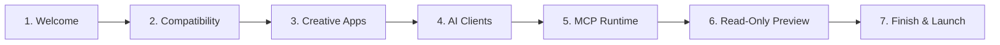

# MADEL Studio Bridge — Phase P25 First-Run Experience
## Interactive 7-Step Setup Wizard Specification & User Flow
**Platform Version:** v0.11.0  
**Owner & Lead Architect:** Mahmoud Adel (`Mahmoudmarktingiq`)

---

## 1. First-Run Trigger Mechanism

When `madel-desktop.exe` starts, the Vue frontend checks:
```ts
if (typeof localStorage !== "undefined" && localStorage.getItem("madel_setup_completed") !== "true") {
  showWizard.value = true;
}
```
If the setup flag is absent or `false`, the 7-step Setup Wizard automatically opens in an elegant modal backdrop. Users can also re-trigger the wizard at any time via the **🧙 Setup Wizard** button in the top navigation header.

---

## 2. 7-Step Setup Wizard Walkthrough



### Step 1: Welcome & Overview
- **Objective:** Introduce the platform, developer ownership (Mahmoud Adel), and primary capabilities.
- **Content:**
  - Non-destructive and safe operations with Action Approval Gate.
  - Local, private execution without telemetry.
  - Zero-breakage guarantee for external client configs.

### Step 2: Compatibility Check
- **Objective:** Verify workstation readiness.
- **Checks:**
  - Windows 10/11 x64 OS release.
  - Node.js runtime version (v20+ LTS / v26+ detected).
  - Microsoft Edge WebView2 runtime.
  - Standard user profile execution context.

### Step 3: Creative Applications Discovery
- **Objective:** Scan and report local creative suite status.
- **Applications Inspected:**
  - Adobe Photoshop (UXP daemon on port 7897).
  - Adobe Illustrator (Standalone delegate).
  - Adobe Premiere Pro (UXP panel).
  - Adobe After Effects (ES3 & aerender runner).
  - Blender 3D (Python addon on WebSocket 9876).
  - CapCut / JianYing (Drafts directory).

### Step 4: AI Clients Detection
- **Objective:** Scan installed AI development tools without touching their configs.
- **Clients Scanned:**
  - Claude Code CLI (`~/.claude.json`).
  - OpenAI Codex (`~/.codex/config.toml`).
  - Google Antigravity IDE (`~/.gemini/antigravity`).
  - Cursor, Windsurf, Claude Desktop, Trae, etc.

### Step 5: MCP Core Runtime Verification
- **Objective:** Confirm active MCP communication channels.
- **Verifications:**
  - Primary TCP Loopback Daemon (`127.0.0.1:7897`).
  - Windows Named Pipe (`\\.\pipe\brainferno-mcp-bridge`).
  - Concurrency Limiter (P17 WorkLimiter active).
  - Action Approval Gate active.

### Step 6: Read-Only Connection Preview
- **Objective:** Explain the safe declarative connection model.
- **Policy:** Explicitly highlights that the discovery phase is strictly read-only. Shows a sample connection diff and informs the user that individual clients can be safely connected from the AI Clients dashboard tab with atomic rollback backups.

### Step 7: Finish & Completion
- **Objective:** Confirm setup completion.
- **Action:** Sets `madel_setup_completed = 'true'` in localStorage, closes the wizard, and directs the user to the live Dashboard.
