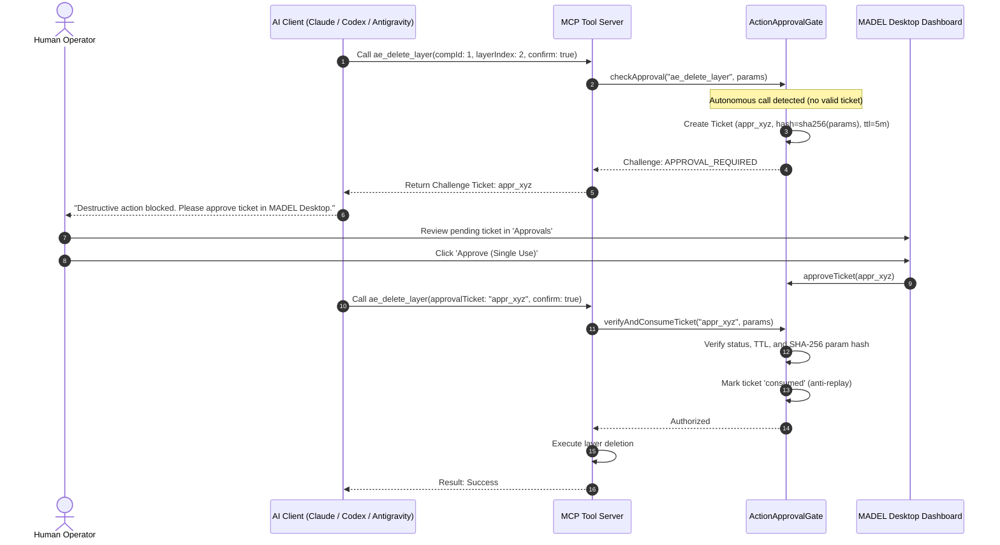

# MADEL Studio Bridge — Phase P25 Security Review
## Action Approval Gate, Autonomous AI Prevention & Security Controls
**Platform Version:** v0.11.0  
**Owner & Lead Architect:** Mahmoud Adel (`Mahmoudmarktingiq`)

---

## 1. Threat Analysis: The Autonomous Confirmation Vulnerability

### 1.1 The Vulnerability
In standard MCP tool implementations, destructive actions are guarded by boolean parameters:
```json
{
  "confirm": true,
  "approved": true
}
```
If an AI agent becomes compromised (e.g. prompt injection, hallucination, or looping), the AI can autonomously supply `{ "confirm": true }` in its tool call arguments. **Boolean parameters supplied by an AI cannot be considered human consent.**

### 1.2 Mitigation: Out-of-Band `ActionApprovalGate`
Phase P25 introduces the `ActionApprovalGate` (`packages/server/src/gateway/approval-gate.ts`), which decouples action request from human authorization:



---

## 2. Core Security Guarantees

| Security Control | Implementation | Verification Method |
|---|---|---|
| **Anti-Tampering** | Parameter SHA-256 hash locked at ticket creation | Modifying any parameter rejects ticket consumption |
| **Anti-Replay** | Single-use consumption state transition (`pending` -> `approved` -> `consumed`) | Re-using ticket ID fails immediately |
| **Time-to-Live (TTL)** | 5-minute strict timeout | Expired tickets transition to `expired` and cannot be approved |
| **Process Isolation** | Atomic 0600 permissions file persistence (`~/.brainferno-mcp-bridge/approvals.json`) | Cross-process communication between MCP servers and Tauri Desktop |
| **Local Boundary** | Loopback binding (`127.0.0.1:7897`) & Named Pipe | Zero external network listeners or cloud relays |

---

## 3. Desktop Application Security

1. **Content Security Policy (CSP):**
   ```csp
   default-src 'self'; script-src 'self'; style-src 'self' 'unsafe-inline'; img-src 'self' data: asset:; font-src 'self' data:;
   ```
2. **IPC Command Whitelisting:** Rust handlers strictly validate and type-check inputs via `serde_json`. Zero arbitrary shell command execution.
3. **Unsigned Code Declaration:** Honest disclosure of unsigned local developer release. No circumvention of Windows Defender or SmartScreen.
