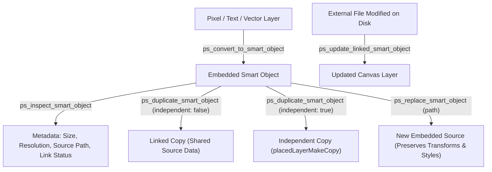

# MADEL Studio Bridge — Phase P20
# Smart Objects Architecture & Engineering Guide
**Architect & Owner:** Mahmoud Adel (`Mahmoudmarktingiq`)  
**Phase:** P20 — Advanced Photoshop Creative Tools  
**Module:** Smart Objects Subsystem  

---

## 1. Overview & Architectural Role

Smart Objects are non-destructive raster/vector containers in Adobe Photoshop that preserve a layer's source content with all original characteristics. They allow:
- Completely reversible non-destructive affine transformations (scaling, rotation, skewing, perspective distortion).
- Re-editable Smart Filters.
- Shared asset synchronization across multiple layer instances.
- Independent decoupling when variants are needed.

MADEL Studio Bridge exposes a complete lifecycle management suite for Smart Objects through 5 dedicated MCP tools.

---

## 2. Smart Object Lifecycle Operations



---

## 3. Tool Implementations & BatchPlay Mechanics

### 3.1 `ps_convert_to_smart_object`
Converts one or more selected layers into an embedded Smart Object layer.
- **Underlying ActionDescriptor:**
  ```javascript
  {
    _obj: "newPlacedLayer",
    _options: { dialogOptions: "dontDisplay" }
  }
  ```
- **Behavior:** The active or targeted layer's pixel data is packaged into an internal `.psb` or embedded asset stream. Subsequent transformations operate solely on the container matrix without resampling the underlying pixels.

### 3.2 `ps_inspect_smart_object`
Extracts internal Smart Object properties from Photoshop's property provider.
- **BatchPlay Target:**
  ```javascript
  {
    _obj: "get",
    _target: [
      { _ref: "property", _property: "smartObjectMore" },
      { _ref: "layer", _id: layerId }
    ]
  }
  ```
- **Returned Metadata:**
  - `isSmartObject`: boolean
  - `details.fileReference`: original file path on disk (if placed)
  - `details.linked`: boolean (true if linked external file, false if embedded)
  - `details.size`: `{ width: number, height: number }` in source pixels
  - `details.resolution`: source DPI

### 3.3 `ps_duplicate_smart_object`
Solves a critical creative dilemma in automated templating:
1. **Linked Duplicate (`independentCopy: false`):**
   Uses `layer.duplicate()`. Both the original and duplicated layer point to the same internal object data. Editing one updates both across the canvas.
2. **Independent Copy (`independentCopy: true`):**
   Uses Photoshop's "New Smart Object via Copy" command:
   ```javascript
   {
     _obj: "placedLayerMakeCopy",
     _options: { dialogOptions: "dontDisplay" }
   }
   ```
   This duplicates the embedded stream into a distinct memory block. Modifications, content replacements, or smart filter edits applied to the copy do not alter the parent layer.

### 3.4 `ps_replace_smart_object`
Replaces the raster content of a Smart Object while retaining its canvas position, rotation, scale factor, layer styles, layer masks, and blend mode.
- **Session Token Exchange:**
  Photoshop UXP enforces local file system isolation. The tool creates an authorized session token via `lfs.createSessionToken(entry)` and passes it to the action manager:
  ```javascript
  {
    _obj: "placedLayerReplaceContents",
    null: { _path: token, _kind: "local" },
    _options: { dialogOptions: "dontDisplay" }
  }
  ```

### 3.5 `ps_update_linked_smart_object`
When an external vector or image file linked to a document is edited externally (e.g. via Adobe Illustrator or an image processing script), this command triggers Photoshop to reload the modified bytes:
```javascript
{
  _obj: "placedLayerUpdateModified",
  _options: { dialogOptions: "dontDisplay" }
}
```

---

## 4. Best Practices for Automated Template Pipelines

1. **Template Creation:** Build layout templates where user-customizable areas (e.g., product photo, logo, background) are Smart Objects.
2. **Non-Destructive Resizing:** Call `ps_replace_smart_object` with varying dimension inputs; Photoshop automatically fits the new asset into the bounding container without stretching if constrained.
3. **Branching Variants:** When creating social media banners with different localized assets, use `ps_duplicate_smart_object(independentCopy: true)` before replacing contents.
