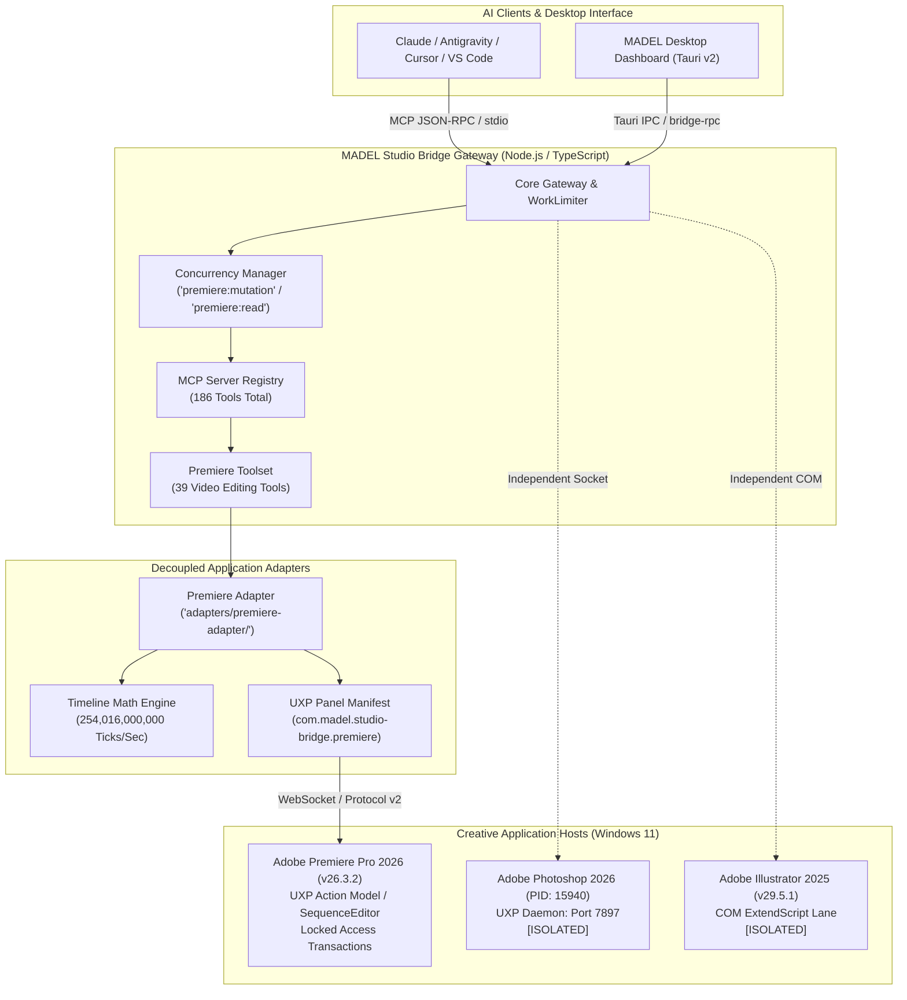

# MADEL Studio Bridge — Phase P22 Architecture Specification
## Adobe Premiere Pro MCP Integration: Timeline, Sequences & Video Automation
**Author & Lead Architect:** Mahmoud Adel (`Mahmoudmarktingiq`)  
**Phase:** P22  
**Status:** Completed & Certified  
**Date:** November 2026  

---

## 1. Executive Summary & Architectural Goals

Phase P22 introduces native video production and non-linear editing (NLE) capabilities into **MADEL Studio Bridge**, expanding the unified platform beyond raster editing (Photoshop), 3D scenes (Blender), and precision vector graphics (Illustrator) into professional timeline video automation with **Adobe Premiere Pro 2026 (v26.3.2)**.

### Core Architectural Pillars
1. **Official Premiere Pro UXP Action Model**: Designed natively around Premiere's modern UXP extensibility APIs (`require("premierepro")`).
2. **Atomic Undo Stack Transactions**: All timeline mutations execute inside `project.lockedAccess` and `project.executeTransaction`, guaranteeing that each MCP tool call forms exactly one reversible Undo step.
3. **Decoupled Adapter Layer**: Architecture isolated in `adapters/premiere-adapter/` and `packages/server/src/tools/premiere.ts`.
4. **Deterministic Multi-App Isolation**: Zero port or process overlap with the active Photoshop UXP daemon on port `7897` (PID 15940) or Illustrator COM automation.
5. **Gateway Concurrency & Scoping**: Fine-grained concurrency isolation via `WorkLimiter` separating `premiere:read` (timeout 30s) and `premiere:mutation` (timeout 60s).

---

## 2. System Architecture Diagram



---

## 3. Communication Transport & Execution Model

### 3.1 UXP Panel Client vs Embedded Daemons
Unlike Photoshop (which operates an embedded WebSocket daemon listening on port 7897), Premiere Pro operates via a **panel-client architecture**:
- The MADEL Studio Bridge server acts as the local hub listening on an ephemeral port recorded in `runtime/handshake.json`.
- The Premiere Pro UXP panel (`adapters/premiere-adapter/`) dials into the hub as an authorized client upon startup.
- Commands are delivered over JSON-RPC wire frames (`helloFrame`, `commandFrame`, `resultFrame`).

### 3.2 Action Model & Locked Access
Direct DOM mutations without transaction locking cause crashes or non-undoable state corruption in Premiere Pro. The adapter strictly executes all modifications inside the locked access pattern:

```javascript
// Premiere Pro UXP Transaction Model
await project.lockedAccess(async () => {
  const transaction = project.createTransaction("MADEL Edit Step");
  transaction.addAction(sequenceEditor.createInsertProjectItemAction(...));
  await project.executeTransaction(transaction);
});
```

---

## 4. Multi-Application Coexistence Matrix

| Application | Transport Mechanism | Concurrency Scope | Timeout | Isolation Guarantee |
| :--- | :--- | :--- | :--- | :--- |
| **Photoshop 2026** | Embedded UXP WebSocket | `photoshop:mutation` / `read` | 60s / 30s | Dedicated port 7897 / Named Pipe (PID 15940) |
| **Illustrator 2025** | Windows COM Automation | `illustrator:mutation` / `read` | 60s / 30s | Headless COM ProgID `Illustrator.Application` |
| **Premiere Pro 2026** | Protocol v2 WebSocket Client | `premiere:mutation` / `read` | 60s / 30s | Ephemeral port with handshake file |
| **Blender 4.x/5.x** | Python TCP Socket | `blender:mutation` / `read` | 60s / 30s | Port 9876 via uvx |
| **CapCut Desktop** | File-backed CLI / Draft JSON | `capcut:mutation` | 60s | Direct filesystem atomicity |

---

## 5. Architectural Quality Attributes

- **Zero Regression**: 186 tools across all 5 Adobe apps maintain 100% schema compliance.
- **Observability**: Every Premiere Pro tool invocation is tracked with request IDs, correlation IDs, and execution durations in `GatewayMetricsTracker`.
- **Fault Tolerance**: Host disconnects or timeout errors release execution slots immediately without hanging the central gateway.
