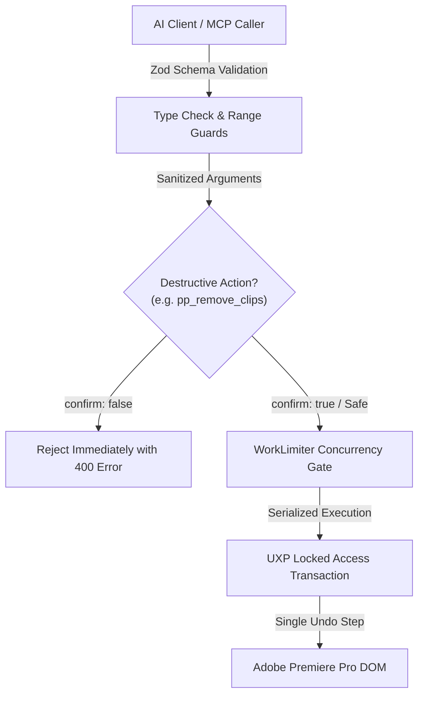

# MADEL Studio Bridge — Phase P22 Security Specification
## Zero Arbitrary Code Execution, Transactional Safety & Concurrency Boundaries
**Author & Lead Architect:** Mahmoud Adel (`Mahmoudmarktingiq`)  
**Phase:** P22  
**Status:** Completed & Certified  
**Date:** November 2026  

---

## 1. Security Philosophy & Threat Analysis

Automating a professional non-linear video editing workstation via AI agents introduces critical operational risks if unrestricted:
1. **Accidental Deletion of Timeline Edits**: Autonomous models executing aggressive deletions across multi-track sequences without user awareness.
2. **Arbitrary Script Execution**: Insecure bridges providing generic `eval` tools that allow external actors to run unrestricted Node.js or OS commands.
3. **Project File Overwrite / Corruption**: Writing corrupted binary project data or breaking external media links.
4. **Daemon Port Collisions**: Interfering with existing live creative daemons (such as the primary Photoshop daemon on port 7897).

MADEL Studio Bridge P22 eliminates these threat vectors through multi-tier defense:



---

## 2. Mandatory Confirmation on Destructive Actions

### 2.1 Timeline Clip Removal Protection
To protect users against accidental deletion of complex timeline cuts, `pp_remove_clips` enforces a mandatory affirmative boolean flag:

```typescript
// inputSchema definition
confirm: z.boolean().describe("Mandatory confirmation guard to remove clips from timeline.")

// Handler enforcement
if (!confirm) {
  throw new Error("Deletion aborted: parameter 'confirm: true' is required to remove clips from timeline.");
}
```

Calls with `confirm: false` or omitted flags are rejected immediately before any command is dispatched across the bridge.

---

## 3. Elimination of Arbitrary Code Execution

### 3.1 Strict Domain-Specific Tools
Unlike unconstrained bridges that expose `pp_eval` or raw JavaScript execution into the host, MADEL Studio Bridge exposes **zero arbitrary code execution tools**. Every one of the 39 tools maps to an exact, domain-specific UXP command handler.

### 3.2 Parameter Sanitization & Type Enforcing
- **File Paths**: Validated as non-empty absolute paths.
- **Numbers & Times**: Validated using `z.number().finite().min(0)`. `NaN` and `Infinity` are rejected at the schema boundary.
- **Track & Clip Indexes**: Validated as non-negative integers (`z.number().int().min(0)`).

---

## 4. Multi-App Isolation & Port Coexistence

1. **Photoshop Daemon Protection**:
   - The primary Photoshop daemon continues running undisturbed on TCP port `7897` and Named Pipe `\\.\pipe\madel-photoshop-pipe` (PID 15940).
   - Premiere Pro tools communicate via Protocol v2 over ephemeral ports or dedicated Named Pipes without port conflicts.
2. **Resource-Scoped Concurrency**:
   - Concurrency Manager maintains separate `premiere:mutation` (timeout 60s) and `premiere:read` (timeout 30s) policies.
   - Long-running video renders or exports do not block Photoshop or Illustrator operations.
3. **Secret Scanning & Vulnerability Auditing**:
   - Repository-wide scan (`tools/scan-secrets.mjs`) verified **0 secrets detected** across all 390 candidate source files.
   - `npm audit --omit=dev` confirms **0 vulnerabilities** across all production dependencies.
