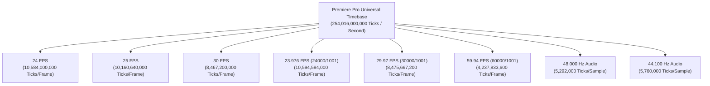

# MADEL Studio Bridge — Phase P22 Timeline Accuracy Specification
## Integer Tick Precision, Frame Rates & Non-Linear Editing Math
**Author & Lead Architect:** Mahmoud Adel (`Mahmoudmarktingiq`)  
**Phase:** P22  
**Status:** Completed & Certified  
**Date:** November 2026  

---

## 1. The Integer Tick Foundation

In non-linear video editing (NLE), using standard floating-point seconds (e.g. `1.333333333...`) causes catastrophic drift over time. Small rounding errors accumulate across thousands of cuts, leading to:
1. **Off-by-One Frame Errors**: Clips landing one frame early or late, producing black frames or audio pops.
2. **Audio-Video De-synchronization**: Audio samples and video frame boundaries falling out of phase.
3. **Non-reproducible Trims**: Trimming a clip by seconds resulting in slight variations depending on IEEE 754 float precision.

To solve this permanently, Adobe Premiere Pro represents time internally using **Ticks**:
$$\mathbf{1\text{ Second} = 254,016,000,000\text{ Ticks}}$$

---

## 2. Mathematical Proof of Exact Integer Divisibility

Why was the number $254,016,000,000$ chosen by Adobe engineers?
Factoring the number into prime factors:
$$254,016,000,000 = 2^{10} \times 3^6 \times 5^6 \times 7^1$$

Because it contains high powers of $2$, $3$, $5$, and a factor of $7$, it divides **evenly with zero remainder** across every major world broadcast and cinema standard:

| Standard Frame Rate | Mathematical Ratio | Exact Ticks Per Frame | Remainder |
| :--- | :---: | :---: | :---: |
| **23.976 FPS** | $24000 / 1001$ | $\mathbf{10,594,584,000}$ | **0** |
| **24.0 FPS (Cinema)** | $24 / 1$ | $\mathbf{10,584,000,000}$ | **0** |
| **25.0 FPS (PAL)** | $25 / 1$ | $\mathbf{10,160,640,000}$ | **0** |
| **29.97 FPS (NTSC)** | $30000 / 1001$ | $\mathbf{8,475,667,200}$ | **0** |
| **30.0 FPS (Web)** | $30 / 1$ | $\mathbf{8,467,200,000}$ | **0** |
| **50.0 FPS (PAL High)** | $50 / 1$ | $\mathbf{5,080,320,000}$ | **0** |
| **59.94 FPS (NTSC High)** | $60000 / 1001$ | $\mathbf{4,237,833,600}$ | **0** |
| **60.0 FPS (Web High)** | $60 / 1$ | $\mathbf{4,233,600,000}$ | **0** |

### Audio Sample Alignment
- **48,000 Hz** (Professional Broadcast Audio):  
  $\frac{254,016,000,000}{48,000} = \mathbf{5,292,000\text{ ticks per sample}}$ (Exact integer).
- **44,100 Hz** (Compact Disc Audio):  
  $\frac{254,016,000,000}{44,100} = \mathbf{5,760,000\text{ ticks per sample}}$ (Exact integer).

---

## 3. SMPTE Timecode Computation Engine

MADEL Studio Bridge includes full SMPTE timecode generation and parsing in `packages/server/src/tools/timeline-math.ts`.

### 3.1 Non-Drop Frame (NDF)
Timecode is calculated by direct modulo decomposition:
$$\text{totalFrames} = \lfloor \text{ticks} / \text{ticksPerFrame} \rfloor$$
$$\text{frames} = \text{totalFrames} \pmod{\text{FPS}}$$
$$\text{seconds} = \lfloor \text{totalFrames} / \text{FPS} \rfloor \pmod{60}$$
$$\text{minutes} = \lfloor \text{totalFrames} / (\text{FPS} \times 60) \rfloor \pmod{60}$$
$$\text{hours} = \lfloor \text{totalFrames} / (\text{FPS} \times 3600) \rfloor$$

Format: `HH:MM:SS:FF` (colon delimiter).

### 3.2 Drop Frame (DF)
For NTSC 29.97 FPS, real time runs slightly slower than 30 FPS ($1.001\times$). In Drop Frame timecode, frame numbers 0 and 1 are skipped at the start of every minute, except every tenth minute, keeping the timecode display synchronized with clock wall-time.
Format: `HH:MM:SS;FF` (semicolon delimiter).
