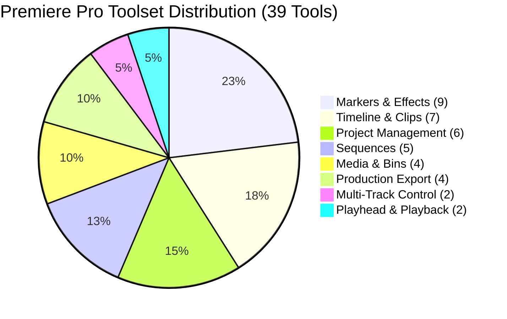

# MADEL Studio Bridge — Phase P22 Tool Registry
## Complete Catalog of 39 Adobe Premiere Pro MCP Tools
**Author & Lead Architect:** Mahmoud Adel (`Mahmoudmarktingiq`)  
**Phase:** P22  
**Status:** Completed & Certified  
**Date:** November 2026  

---

## 1. Overview of Tools

The MADEL Studio Bridge Adobe Premiere Pro integration provides **39 specialized MCP tools** across 8 functional domains. Every tool is strictly typed via Zod v4 schemas, validated at the wire boundary, protected by error guards, and assigned to the deterministic Gateway Concurrency Manager.

---

## 2. Category 1: Project Management (6 Tools)

| Tool Name | Scope | Description | Primary Parameters |
| :--- | :--- | :--- | :--- |
| `pp_project_info` | `premiere:read` | Read open project name, path, sequence count, and active sequence. | None |
| `pp_inspect_project_metadata` | `premiere:read` | Detailed project telemetry including item counts, sequence counts, and modified status. | None |
| `pp_open_project` | `premiere:mutation` | Opens an existing `.prproj` project file. | `path` |
| `pp_create_project` | `premiere:mutation` | Creates a new `.prproj` project at an absolute path. | `path` |
| `pp_save_project` | `premiere:mutation` | Saves the active project in-place or saves a copy. | `path` (optional for Save As) |
| `pp_list_project_items` | `premiere:read` | Lists every item in the project panel (clips, sequences, bins) with IDs and media paths. | None |

---

## 3. Category 2: Media Management & Bins (4 Tools)

| Tool Name | Scope | Description | Primary Parameters |
| :--- | :--- | :--- | :--- |
| `pp_import_files` | `premiere:mutation` | Imports media files (video, audio, stills) into the project root. | `paths` (array of file paths), `asNumberedStills` |
| `pp_inspect_media` | `premiere:read` | Inspects source media item properties, resolution, duration, and file path. | `projectItemId` |
| `pp_create_bin` | `premiere:mutation` | Creates an organization bin (folder) in the project panel. | `name`, `parentBinId` (optional) |
| `pp_move_project_item` | `premiere:mutation` | Moves a project item into a designated target bin. | `projectItemId`, `targetBinId` |

---

## 4. Category 3: Sequence Management (5 Tools)

| Tool Name | Scope | Description | Primary Parameters |
| :--- | :--- | :--- | :--- |
| `pp_list_sequences` | `premiere:read` | Lists all sequences with ID, track counts, and length in seconds. | None |
| `pp_create_sequence` | `premiere:mutation` | Creates a sequence from media or using a `.sqpreset` preset. | `name`, `projectItemIds`, `presetPath` |
| `pp_get_sequence` | `premiere:read` | Reads complete sequence details: frame size, FPS, in/out, tracks, and clips. | `sequenceId` |
| `pp_set_active_sequence` | `premiere:mutation` | Switches active sequence and opens it in timeline view. | `sequenceId` |
| `pp_get_sequence_duration` | `premiere:read` | Reads exact duration in seconds, integer ticks, frames, and SMPTE timecode. | `sequenceId`, `fps` (optional override) |

---

## 5. Category 4: Multi-Track Control (2 Tools)

| Tool Name | Scope | Description | Primary Parameters |
| :--- | :--- | :--- | :--- |
| `pp_list_video_tracks` | `premiere:read` | Lists all video tracks with name, index, lock status, and clip count. | `sequenceId` |
| `pp_list_audio_tracks` | `premiere:read` | Lists all audio tracks with name, channel format (stereo/mono/5.1), lock, mute, and solo flags. | `sequenceId` |

---

## 6. Category 5: Timeline & Clip Manipulation (7 Tools)

| Tool Name | Scope | Description | Primary Parameters |
| :--- | :--- | :--- | :--- |
| `pp_insert_clip` | `premiere:mutation` | Inserts or overwrites a project item on the timeline at a specific second. | `sequenceId`, `projectItemId`, `seconds`, `videoTrackIndex`, `audioTrackIndex`, `mode` (`insert`/`overwrite`), `limitShift` |
| `pp_insert_mogrt` | `premiere:mutation` | Places a Motion Graphics template (`.mogrt`) on the timeline. | `sequenceId`, `path`, `seconds`, `videoTrackIndex`, `audioTrackIndex` |
| `pp_inspect_clip` | `premiere:read` | Deep inspection of a clip: start/end, source in/out, duration, and timecode. | `sequenceId`, `trackType`, `trackIndex`, `clipIndex` |
| `pp_move_clip` | `premiere:mutation` | Relocates a clip to a new start time on its track. | `sequenceId`, `trackType`, `trackIndex`, `clipIndex`, `seconds` |
| `pp_trim_clip` | `premiere:mutation` | Adjusts timeline edges (start/end) and source in/out points. | `sequenceId`, `trackType`, `trackIndex`, `clipIndex`, `startSeconds`, `endSeconds`, `inSeconds`, `outSeconds` |
| `pp_remove_clips` | `premiere:mutation` | Deletes clips with ripple editing. **Requires mandatory `confirm: true`**. | `sequenceId`, `clips` (array of track/clip refs), `ripple`, `confirm: true` |
| `pp_set_clip_props` | `premiere:mutation` | Renames or enables/disables a timeline clip. | `sequenceId`, `trackType`, `trackIndex`, `clipIndex`, `name`, `disabled` |

---

## 7. Category 6: Playhead & Playback (2 Tools)

| Tool Name | Scope | Description | Primary Parameters |
| :--- | :--- | :--- | :--- |
| `pp_get_player_position` | `premiere:read` | Reads current playhead position in seconds, integer ticks, and SMPTE timecode. | `sequenceId` |
| `pp_set_player_position` | `premiere:mutation` | Sets the playhead to an exact point in seconds. | `sequenceId`, `seconds` |

---

## 8. Category 7: Markers & Effects (9 Tools)

| Tool Name | Scope | Description | Primary Parameters |
| :--- | :--- | :--- | :--- |
| `pp_list_markers` | `premiere:read` | Lists sequence markers with name, type, time, and comments. | `sequenceId` |
| `pp_add_marker` | `premiere:mutation` | Adds a marker to a sequence at a specific time. | `sequenceId`, `name`, `seconds`, `durationSeconds`, `comments`, `type` |
| `pp_list_transitions` | `premiere:read` | Lists installed video transition match names. | None |
| `pp_add_transition` | `premiere:mutation` | Adds a transition (e.g. Cross Dissolve) to the start or end of a clip. | `sequenceId`, `trackType`, `trackIndex`, `clipIndex`, `matchName`, `position`, `durationSeconds` |
| `pp_list_effects` | `premiere:read` | Lists installed video and audio effect filter match names. | None |
| `pp_get_clip_effects` | `premiere:read` | Lists effect components on a clip (Motion, Opacity, etc.) and their keyframes. | `sequenceId`, `trackType`, `trackIndex`, `clipIndex` |
| `pp_apply_effect` | `premiere:mutation` | Applies an effect component to a clip. | `sequenceId`, `trackType`, `trackIndex`, `clipIndex`, `effect` |
| `pp_remove_effect` | `premiere:mutation` | Removes an effect component from a clip. | `sequenceId`, `trackType`, `trackIndex`, `clipIndex`, `component` |
| `pp_set_effect_param` | `premiere:mutation` | Modifies an effect parameter value or adds a keyframe. | `sequenceId`, `trackType`, `trackIndex`, `clipIndex`, `component`, `param`, `value`, `seconds`, `interpolation` |

---

## 9. Category 8: Production Export (4 Tools)

| Tool Name | Scope | Description | Primary Parameters |
| :--- | :--- | :--- | :--- |
| `pp_inspect_export_capabilities` | `premiere:read` | Inspects supported export modes, hardware encoders, and codecs. | None |
| `pp_list_export_presets` | `premiere:read` | Finds installed encoder presets (`.epr`) by filter. | `filter`, `limit` |
| `pp_export_frame` | `premiere:read` | Renders a single frame to PNG for visual inspection. | `sequenceId`, `seconds`, `maxDimension` |
| `pp_export_sequence` | `premiere:mutation` | Exports sequence using an `.epr` preset via Premiere or Media Encoder. | `sequenceId`, `outputPath`, `presetPath`, `mode` (`immediately`/`queue_ame`), `full`, `wait` |
