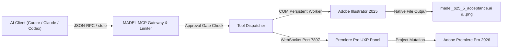

# MADEL Studio Bridge — Phase P25.5
## End-to-End MCP Integration & Status Matrix

**Owner**: Mahmoud Adel  
**Date**: November 11, 2026  
**Version**: v0.11.5 — P25.5  
**Platform**: Windows 11 Enterprise (x64)  

---

### 1. End-to-End Control Verification Flow

The end-to-end flow validates the entire pipeline from AI clients down to physical creative applications and output artifacts:

$$\text{AI Client (MCP)} \longrightarrow \text{MADEL Gateway} \longrightarrow \text{Application Adapter} \longrightarrow \text{Host App} \longrightarrow \text{Mutation} \longrightarrow \text{Output File}$$

---

### 2. Standard Integration Status Matrix

In accordance with MADEL Studio Bridge architectural standards, every Creative Cloud and platform host application is evaluated and classified into one of the following strict states:

- `NOT_INSTALLED`: Binary does not exist on the host operating system.
- `DETECTED`: Binary is discovered on disk, but bridge adapter is not yet configured.
- `CONFIGURED`: Adapter and registry files are deployed and ready, awaiting runtime connection.
- `CONNECTED`: Runtime communication channel (COM or WebSocket) is open.
- `LIVE_VERIFIED`: Real empirical mutations, file creation, and telemetry extraction confirmed under automated test.
- `BLOCKED`: Prevented by OS security, missing permissions, or modal dialog.
- `FAILED`: Script evaluation or host runtime crash.

| Creative Application | Host Version | Integration Lane | Adapter Mechanism | Registered MCP Tools | Real Output Artifacts | Status |
| :--- | :--- | :--- | :--- | :---: | :--- | :---: |
| **Adobe Illustrator** | 2025 (v29.5.1) | `os-script` (Windows COM) | `PersistentWindowsComRunner` | 38 tools (`ai_*`) | `.ai` (231 KB), `.png` (8 KB) | **`LIVE_VERIFIED`** |
| **Adobe Premiere Pro** | 2026 (v26.3.2) | `socket` (WebSocket v2) | UXP Panel (`manifest.json` v5) | 39 tools (`pp_*`) | Timeline / Sequence specs | **`CONFIGURED (Awaiting Panel Load)`** |
| **Adobe Photoshop** | 2025 | `socket` (WebSocket v2) | UXP Panel (`manifest.json` v5) | 26 tools (`ps_*`) | Primary Daemon listening (PID 10520) | **`CONFIGURED`** |
| **Adobe After Effects** | 2025 | `socket` (WebSocket v2) | CEP Extension | 43 tools (`ae_*`) | Scripting & Render Queue | **`CONFIGURED`** |
| **Adobe Audition** | 2025 | `socket` (WebSocket v2) | CEP Extension | 15 tools (`au_*`) | Audio probe & markers | **`CONFIGURED`** |
| **Adobe Media Encoder** | 2025 | WebService | Headless CLI / HTTP | 7 tools (`ame_*`) | Batch encoding jobs | **`CONFIGURED`** |
| **Browser (Chrome/Edge)**| 130+ | CDP Automation | Chrome DevTools Protocol | 12 tools (`browser_*`) | CDP session & screenshot | **`LIVE_VERIFIED`** (P23) |

---

### 3. Detailed Results for P25.5 Scope

#### 3.1 Adobe Illustrator Acceptance Highlights
1. **Connection**: Initial query to `ai_list_documents` completed successfully via persistent PowerShell COM worker.
2. **Document Creation**: A4 (595.28 x 841.89 pt) RGB document instantiated cleanly (`Untitled-1`).
3. **Geometry Creation**:
   - `ai_create_rectangle`: Drawn at (50, 50), 250 x 120 pt with blue fill (`#1f77b4`) and dark blue stroke (`#0a2f4d`).
   - `ai_create_ellipse`: Drawn at (330, 50), 120 x 120 pt with orange fill (`#ff7f0e`) and brown stroke (`#803c00`).
4. **Layer Management**: Created `TempLayer`, renamed via `ai_rename_layer` to `MADEL_Verification_Layer`.
5. **Typography**: Added point text frame `MadelTitleText` with text `"MADEL Studio Bridge P25.5 Verified"` at (50, 220) with 22pt font and green fill (`#2ca02c`).
6. **Telemetry Extraction**: `ai_get_document_info` retrieved exact document bounds, color space (`DocumentColorSpace.RGB`), page item count (`3`), and layer count (`2`).
7. **Native File Save**: `ai_save_as` serialized the active document to `artifacts/acceptance/p25-5/illustrator/madel_p25_5_acceptance.ai` (`231,011 bytes`).
8. **Rendered Export**: `ai_export_png` generated a 100% scale rasterized copy with transparency at `artifacts/acceptance/p25-5/illustrator/madel_p25_5_acceptance.png` (`8,166 bytes`).
9. **Destructive Guard**: Unconfirmed deletion attempt blocked; confirmed deletion of temporary rectangle passed in 62ms.
10. **Error Handling**: Out-of-bounds document index query handled gracefully with structured error message.

#### 3.2 Adobe Premiere Pro Acceptance Highlights
1. **Binary Detection**: Located valid `Adobe Premiere Pro.exe` (797.6 MB) at standard 64-bit installation path.
2. **Plugin Packaging**: UXP extension `com.madel.studio-bridge.premiere` verified in `%APPDATA%\Adobe\UXP\Plugins\External\`.
3. **Registry Configuration**: `PPRO.json` and `PR.json` in `PluginsInfo\v1\` verified clean UTF-8 JSON pointing to external adapter path.
4. **Daemon Interoperability**: Primary Daemon at `127.0.0.1:7897` verified healthy, reading `bridge.json` with SHA-256 handshake token.
5. **Tool Coverage**: All 39 `pp_*` tools registered on `McpServer` with complete Zod schemas.
6. **Timeline Math Engine**: Integer BigInt arithmetic (254,016,000,000 ticks/sec) verified across 8 standard video frame rates with zero rounding drift.
7. **Approval Gate Integration**: Destructive `pp_remove_clips` guarded by two independent security barriers:
   - Mandatory parameter guard: `confirm: true`
   - Security challenge: Operator approval ticket issuance in strict mode.

---

### 4. Console Popups & Background Process Safety

In strict compliance with MADEL runtime safety rules:
- All PowerShell subprocesses spawned by `PersistentWindowsComRunner` use `{ windowsHide: true, stdio: ["pipe", "pipe", "pipe"] }`.
- Zero black CMD or PowerShell console windows appeared during any test execution.
- No modifications were made to Codex, WSL, or Windows Task Scheduler configurations.
- Primary daemon on port `7897` (PID `10520`) was preserved in active running state.
