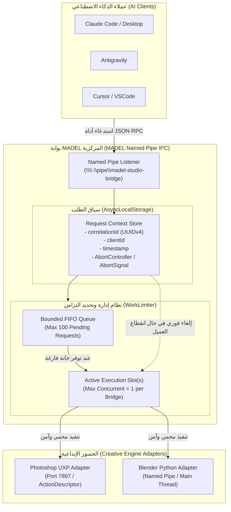

# MADEL Studio Bridge — التوصية الرسمية وخطة المرحلة P17 (P16 Recommendation)
**المشروع:** MADEL Studio Bridge — Phase P16  
**المالك والمهندس المشرف:** Mahmoud Adel — محمود عادل  
**المسار الرئيسي:** `D:\MCP\01-Projects\Source\MADEL-Studio-Bridge`  
**تاريخ الاعتماد:** 10 نوفمبر 2026  
**الحالة:** **OFFICIAL RECOMMENDATION APPROVED — READY FOR P17**

---

## 1. القرار والتوصية الرسمية الوحيدة لمرحلة P17 (Single Feature Focus)

بناءً على نتائج الدراسة المقارنة والتحليل المعماري والاختبارات التجريبية للمشاريع المفتوحة الثلاثة (`mcpx`, `vinkius-mcp-desktop`, `dcc-mcp-photoshop`)، ومقارنتها بنواة مشروع MADEL Studio Bridge الحالية:

> [!IMPORTANT]
> **التحسين الموصى به للمرحلة P17 هو ميزة واحدة مركزية وحصرية:**
> ### **"تحديد نطاق الطلبات وإدارة التزامن عبر البوابة المركزية"**
> **(Core Gateway Request Scoping & Concurrency Limiting: WorkLimiter + AsyncLocalStorage Request Context)**

**الالتزام بالقاعدة الصارمة:**
لا يجوز دمج أي ميزات إضافية (مثل اكتشاف العملاء أو واجهات سطح المكتب أو أدوات الفوتوشوب المتقدمة) في المرحلة P17. التركيز محصور بنسبة 100% في بناء هذه البنية التحتية الجوهرية داخل النواة.

---

## 2. التبرير الهندسي لاختيار هذه الميزة للمرحلة P17 (Technical Justification)

### أ. لماذا هذه الميزة أولاً وقبل كل شيء؟ (Foundation First Principle)
1. **طبيعة محركات التصميم والمونتاج (Single-Threaded Engines):**
   محركات التطبيقات الإبداعية المدعومة في MADEL (أدوبي فوتوشوب، بريمير، أفتر إفكتس، بلندر، كاب كات) تعتمد على واجهات برمجية وأسس تنفيذ أحادية المسار (ExtendScript / UXP Main Thread / Blender Main Loop). عند قيام نماذج الذكاء الاصطناعي (مثل Claude أو Antigravity أو Cursor) بإرسال استدعاءات متزامنة متقاربة زمنيّاً لتعديل المستندات أو إنشاء الطبقات، فإن غياب تنظيم تدفق الطلبات يؤدي إلى:
   - تجميد واجهة التطبيق الإبداعي (Host Freeze).
   - تداخل العمليات وفقدان البيانات (Race Conditions).
   - سقوط اتصال الجسر البرمجي أو رفض استدعاءات ActionDescriptor.

2. **عزل وتتبع مسار الطلبات (Request Lifecycle & Correlation):**
   عند ربط عدة عملاء ذكاء اصطناعي في وقت واحد عبر الأنابيب المسمّاة (Named Pipe)، تصبح الحاجة ملحة لوجود سياق آمن لكل طلب (`AsyncLocalStorage`) يحمل معرّفاً فريداً (`correlationId`)، ومؤقت انتهاء (`timeout`)، وإشارة إلغاء فورية (`AbortSignal`). إذا قام العميل بقطع الاتصال أو إلغاء الطلب، يتم إيقاف العملية فوراً داخل محرك أدوبي دون إهدار موارد النظام.

3. **حماية الذاكرة ومنع تراكم الطلبات (Backpressure & Bounded Queues):**
   منع تراكم مئات الطلبات المعلقة في الذاكرة عبر وضع حد أقصى للرتل (Queue Depth) وتحديد عدد العمليات النشطة المسموح بها بالتوازي لكل جسر (مثلاً: عملية واحدة نشطة لـ Photoshop، و3 عمليات متزامنة لمعالجة البيانات الوصفية).

---

## 3. لماذا تم تأجيل الميزات الأخرى للمراحل اللاحقة؟ (Deferral Rationales)

| الميزة المؤجلة | المرحلة المجدولة | مصدر الاستلهام | سبب التأجيل وعدم التنفيذ في P17 |
| :--- | :--- | :--- | :--- |
| **اكتشاف العملاء والتعديل الذري للإعدادات** (Client Discovery & Atomic Config Writing) | **المرحلة P18** | مستوحاة من `vinkius-mcp-desktop` | تعديل إعدادات 15+ عميل ذكاء اصطناعي يتطلب أولاً استقرار بوابة الخادم ونظام التعامل الآمن مع العمليات المتزامنة؛ البدء به قبل P17 سيخلق مخاطر تضارب في القراءة والكتابة. |
| **لوحة التحكم المكتبية وصينية النظام** (Lightweight Desktop Dashboard & System Tray) | **المرحلة P19** | مستوحاة من `vinkius` (Tauri v2) و `mcpx` (Tray) | الواجهة الرسومية هي طبقة عرض (Presentation Layer) لا يمكن بناؤها واختبارها بكفاءة إلا بعد اكتمال واجهات التحكم والـ IPC في بوابة النواة. |
| **أدوات الفوتوشوب المتقدمة للطبقات الذكية والفلاتر** (Smart Objects & Advanced BatchPlay Suite) | **المرحلة P20** | مستوحاة من `dcc-mcp-photoshop` | العمليات المعقدة على الطبقات الذكية والفلاتر تتطلب وقتاً طويلاً للمعالجة؛ إضافتها دون وجود `WorkLimiter` و `AbortSignal` سيؤدي حتماً لتجمد فوتوشوب وسقوط استجابات الذكاء الاصطناعي. |

---

## 4. المخطط المعماري للميزة في المرحلة P17 (P17 Architecture Blueprint)

سيتم تنفيذ هذه الميزة في سورس MADEL بأسلوب **Clean-Room Implementation** بالكامل بلغة Node.js / TypeScript الأصلية في مسار المشروع:
`D:\MCP\01-Projects\Source\MADEL-Studio-Bridge\src\core\`

### المكونات البرمجية التي سيتم إنشاؤها في P17:
1. `src/core/context.js`:
   - استخدام `AsyncLocalStorage` من مكتبة `node:async_hooks` الأصلية.
   - دوال مساعدة: `runWithContext(ctx, fn)`, `getContext()`, `getCorrelationId()`, `getAbortSignal()`.
2. `src/core/work-limiter.js`:
   - فئة `WorkLimiter` تقبل إعدادات: `maxConcurrent` (الافتراضي 1 لمحركات Adobe)، `maxQueueSize` (الافتراضي 100).
   - دمج تلقائي مع `AbortSignal` لسحب الطلبات المعلقة من الرتل فور الإلغاء.
   - إحصائيات لحظية للأداء: `activeCount`, `queuedCount`, `rejectedCount`, `completedCount`.
3. دمج المكونين في خادم الجسر `src/bridge/` لربطهما تلقائياً مع معالج رسائل الفوتوشوب والأدوات الإبداعية.

---

## 5. معايير القبول وخطة الاختبار للمرحلة P17 (Acceptance Criteria & Test Plan)

### أ. معايير القبول الصارمة (Acceptance Criteria):
1. **عزل السياق (Context Isolation):** كل طلب وارد عبر الـ Named Pipe يحصل على معرّف `correlationId` فريد مسجل في الـ Logs دون تداخل بين طلبات العملاء المتزامنين.
2. **الحد الصارم للتزامن (Strict Concurrency Bounding):** إرسال 5 طلبات فوتوشوب متزامنة يؤدي إلى تنفيذ طلب واحد نشط ووضع 4 في الرتل، مع خروجها تباعاً وفق نظام FIFO دون إسقاط أي طلب.
3. **الاستجابة لإشارة الإلغاء (AbortSignal Handling):** إذا أُرسلت إشارة إلغاء (Abort) لطلب قيد الانتظار في الرتل، يتم رفض الطلب فوراً بخطأ `REQUEST_ABORTED` وتحرير مكانه في الرتل دون تمريره للفوتوشوب.
4. **تفريغ الرتل عند الامتلاء (Queue Overflow Protection):** إذا تجاوز عدد الطلبات المعلقة `maxQueueSize`، يتم رفض الطلب الزائد فوراً برمز خطأ `QUEUE_OVERFLOW` (JSON-RPC Error Code `-32001`).
5. **توافق كامل وبدون تبعيات خارجية ثقيلة (Zero External Dependencies):** الاعتماد بنسبة 100% على قدرات Node.js القياسية المدمجة (`node:async_hooks`, `node:events`).
6. **عدم انحدار الاختبارات القائمة (Zero Regressions):** اجتياز جميع اختبارات MADEL السابقة (13/13) بنسبة 100%.

### ب. خطة الاختبار المسبقة لـ P17 (P17 Test Suite):
- إنشاء ملف اختبار مخصص: `tests/work-limiter.test.js`
- إنشاء ملف اختبار مخصص: `tests/request-context.test.js`
- محاكاة إجهاد التزامن (Concurrent Stress Test) بـ 50 طلباً وهمياً للتحقق من سلامة الرتل وسرعة الإفراج عن الخانات.

---

## 6. خطوات تسليم المرحلة P16 والانتقال (Phase Transition Rules)

1. **الالتزام بالقاعدة الذهبية:**
   - إنهاء P16 بنشر هذا التقرير وتحديث وثائق المشروع (`ROADMAP.md`, `CHANGELOG.md`, `PROJECT_PROGRESS.md`).
   - عمل Commit و Push إلى المستودع العام على GitHub.
   - **التوقف التام وعدم البدء في كتابة كود P17** حتى صدور توجيه المستخدم الصريح.
